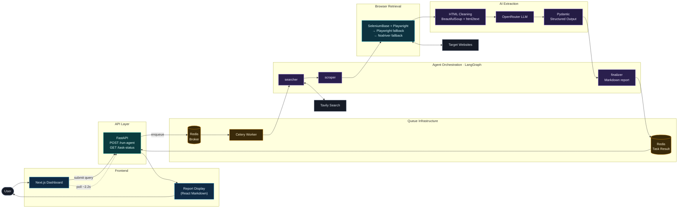
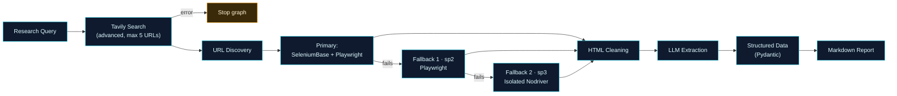

<p align="center">
  
</p>

<p align="center"><b>From a research query to structured market intelligence.</b></p>

<p align="center">
  
  
  
  
  
  
  
  
  
  
</p>

---

## Overview

**CogniPulse** is an AI-powered market research and competitor intelligence platform. A user submits a research query in a web dashboard. The backend then:

1. Discovers relevant sources with **Tavily**.
2. Retrieves page content with **layered browser automation**.
3. Cleans the HTML and sends the text to an **OpenRouter-hosted LLM**.
4. Validates the extracted data with **Pydantic** schemas.
5. Compiles the findings into a **Markdown intelligence report**.

The pipeline is orchestrated by **LangGraph** and runs asynchronously on **Celery + Redis**, so long research jobs never block an HTTP request.

> An independently developed portfolio project demonstrating backend engineering, agentic AI workflows, web automation, LLM integration, asynchronous processing, and full-stack development.

## Key Features

- **Stateful agent workflow:** a LangGraph `StateGraph` with `searcher`, `scraper` and `finalizer` nodes, plus conditional routing that stops the run on error.
- **Layered retrieval:** SeleniumBase + Playwright first, then a Playwright fallback, then an isolated Nodriver process.
- **Structured LLM extraction:** Pydantic v2 schemas, strict "use only the supplied page content" instructions, API-key rotation and rate-limit retries.
- **Non-blocking execution:** FastAPI returns `202` with a task ID while a Celery worker runs the pipeline.
- **Research dashboard:** Next.js 15 / React 19 UI with live task status, activity timeline, Markdown report rendering, and copy / download / JSON export.
- **Containerized stack:** Docker Compose with four services (Redis, API, Celery worker, frontend).

## Architecture



## End-to-End Workflow



## Technology Stack

| Category | Technologies |
|---|---|
| **Backend** | Python 3.12, FastAPI, Uvicorn, Pydantic v2, asyncio, Celery, Redis |
| **Agentic AI & LLM** | LangGraph (StateGraph, conditional routing), OpenRouter, OpenAI Python SDK, structured outputs, API-key rotation, retry handling |
| **Search & Extraction** | Tavily Search API, SeleniumBase, Playwright, Nodriver, BeautifulSoup4, html2text, Chromium |
| **Frontend** | Next.js 15, React 19, TypeScript, React Markdown, Remark GFM, Framer Motion, GSAP + ScrollTrigger, Lucide React |
| **DevOps** | Docker, Docker Compose, environment-based configuration |

## Engineering Skills Demonstrated

| Area | Demonstrated in this project |
|---|---|
| **Python & Backend** | REST API design with FastAPI, Pydantic v2 models, asyncio, error handling, modular backend layout |
| **Agentic AI & LLM** | LangGraph state management and conditional routing, OpenAI-compatible integration via OpenRouter, schema-validated extraction, key rotation, retries |
| **Web Automation** | Multi-engine browser retrieval, dynamic page rendering, HTML parsing and content normalization |
| **Distributed Systems** | Celery task queues, Redis broker/result backend, task-status tracking, concurrency, multiprocessing isolation, timeout and process management |
| **Full-Stack** | Next.js / React / TypeScript dashboard, REST integration, Markdown rendering, UI animation |
| **DevOps** | Multi-service Docker Compose setup, multi-stage frontend image, environment-based configuration |

## Engineering Challenges & Solutions

| Challenge | Engineering approach |
|---|---|
| **JavaScript-rendered sites** | Browser automation (SeleniumBase + Playwright over CDP) with scrolling and interaction instead of plain HTTP requests. |
| **Inconsistent page structure** | BeautifulSoup strips navigation, scripts, forms, iframes and ad/sidebar elements; html2text and whitespace normalization produce clean LLM input. |
| **Browser failures and timeouts** | Retries, a Playwright fallback (`sp2`), and a Nodriver fallback (`sp3`) in an isolated multiprocessing worker with explicit timeouts and process-tree cleanup. |
| **Long-running workflows** | Celery + Redis move the pipeline out of the request cycle; the API returns a task ID and exposes status for polling. |
| **LLM consistency and rate limits** | Pydantic output schemas, configurable model name, multiple rotated OpenRouter keys, and retry handling for rate-limit errors. |

<details>
<summary><b>Implementation details</b></summary>

- **Search node:** Tavily advanced depth, up to 5 URLs per request; YouTube, Facebook, Instagram, TikTok and Vimeo are filtered out.
- **Scraper node:** concurrent URL retrieval with asyncio; LLM parsing is limited by a semaphore of 3.
- **LLM input:** raw page text capped at 100,000 characters.
- **Schemas:** `CompetitorProductItem` (`title`, `price_or_budget`, `key_features_or_specs`, `status_or_availability`) and `EnterpriseCompetitorReport` (`competitor_name`, `overall_market_summary`, `items_found`, `pricing_strategy_insight`). The final report currently renders the summaries and item-level data, not every schema field.
- **Celery:** JSON serialization, Redis broker and backend, task time limits, late acknowledgements, prefetch configuration; the Compose worker runs with the solo pool.
- **Frontend:** the active dashboard lives in `frontend/app/page.tsx`.

</details>

## Quick Start

**Prerequisites:** Python 3.12, Node.js, Chromium, a running Redis instance, a [Tavily](https://tavily.com) key and an [OpenRouter](https://openrouter.ai) key.

```bash
git clone https://github.com/<your-username>/CogniPulse-AI-Market-Intelligence.git
cd CogniPulse-AI-Market-Intelligence
cp .env.example .env        # then fill in your keys
```

### Environment variables

```env
TAVILY_API_KEYS=YOUR_TAVILY_API_KEY
OPENROUTER_API_KEYS=YOUR_OPENROUTER_API_KEY
llm_model_name=YOUR_OPENROUTER_MODEL
REDIS_URL=redis://localhost:6379/0
```

Both `*_API_KEYS` variables accept comma-separated values; the key-rotation logic cycles through them.

### Run locally

```bash
# 1. Backend API
cd backend
pip install -r requirements.txt
uvicorn agent_graphs:app --host 0.0.0.0 --port 8800

# 2. Celery worker (separate terminal)
cd backend
celery -A agent_graphs.celery_app worker --loglevel=info -P solo

# 3. Frontend (separate terminal)
cd frontend
npm install
npm run dev
```

Open the dashboard at `http://localhost:3000` and the API docs at `http://localhost:8800/docs`.

### Run with Docker Compose

Compose defines `redis`, `backend` (port `8800`), `celery_worker` and `frontend` (port `3000`).

> **Configuration required:** the supplied `docker-compose.yml` passes only `REDIS_URL` to the backend and worker. `TAVILY_API_KEYS`, `OPENROUTER_API_KEYS` and `llm_model_name` must also reach both services, for example by adding `env_file: .env` to `backend` and `celery_worker`:
>
> ```yaml
> backend:
>   env_file: .env
> celery_worker:
>   env_file: .env
> ```

```bash
docker compose up --build
```

<details>
<summary><b>Setup notes</b></summary>

- The backend Dockerfile's default command references `api_main:app`; Compose overrides it with `uvicorn agent_graphs:app --host 0.0.0.0 --port 8800`. Use that command, not the Dockerfile default.
- Running `python agent_graphs.py` directly starts on port 8000 and is not the supported startup path.
- The dashboard initializes its API base URL to `http://127.0.0.1:8800/` and does not read `NEXT_PUBLIC_API_BASE_URL`. Change the endpoint from the dashboard's API settings if needed.
- A legacy frontend API helper references older proposal-generation routes. It is not the active CogniPulse API.

</details>

## API Endpoints

| Method | Endpoint | Purpose |
|---|---|---|
| `GET` | `/` | Backend service health/status |
| `POST` | `/api/v1/run-agent` | Submit a research query and enqueue a background task (returns `202` + task ID) |
| `GET` | `/api/v1/task-status/{task_id}` | Task state, readiness, success status where available, and result |
| `GET` | `/docs` | Interactive Swagger documentation |

**Submit a query**

```bash
curl -X POST http://localhost:8800/api/v1/run-agent \
  -H "Content-Type: application/json" \
  -d '{"query": "Analyze the electric vehicle market and identify competitors, product prices, and key specifications."}'
```

**Check task status** (use the task ID returned above)

```bash
curl http://localhost:8800/api/v1/task-status/<task_id>
```

## Project Structure

```text
CogniPulse-AI-Market-Intelligence/
├── backend/
│   ├── agent_graphs.py      # FastAPI app, Celery app, LangGraph workflow
│   ├── search_setup.py      # Tavily search
│   ├── scraper_engine.py    # Scraping orchestration
│   ├── scraping_retr.py     # Playwright fallback (sp2)
│   ├── scraping_retr_2.py   # Isolated Nodriver fallback (sp3)
│   ├── parser_engine.py     # LLM extraction and Pydantic schemas
│   ├── bs4_engine.py        # HTML cleaning
│   ├── Dockerfile
│   └── requirements.txt
├── frontend/
│   ├── app/                 # Dashboard (page.tsx)
│   ├── components/
│   ├── lib/
│   ├── Dockerfile
│   └── package.json
├── docker-compose.yml
├── .env.example
├── requirements.txt
└── README.md
```

## Current Limitations

This is a portfolio implementation, not a production-hardened system.

- No authentication or authorization; FastAPI CORS allows all origins.
- No database-backed report storage or persistent research history; the activity timeline covers the current run only.
- Redis has no persistent volume or health check in the supplied Compose file.
- Web scraping is best-effort and cannot guarantee access to every website.
- Each search is limited to a maximum of five URLs.
- The supplied Celery worker uses the solo pool.
- LLM output should be reviewed by a human before informing business decisions.
- No complete automated test suite or CI/CD pipeline is established yet.

## Future Roadmap

*Planned work only; none of these are implemented.*

- [ ] Persistent report and task storage with research history
- [ ] Task cancellation
- [ ] Authentication, authorization and restricted CORS
- [ ] Improved observability
- [ ] Automated testing and CI/CD
- [ ] Production-oriented deployment configuration
- [ ] Configurable research depth
- [ ] Advanced report exports
- [ ] Improved task and worker scalability

## Author

**[Mr Faizan]**: Software Engineer, Python, Agentic AI & Full-Stack Development
[GitHub](https://github.com/mrfaizan-dev) · [LinkedIn](https://www.linkedin.com/in/<your-handle>)
