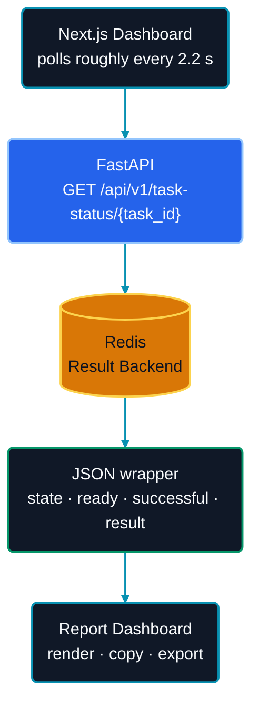
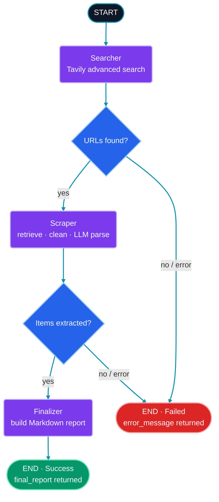

<div align="center">



<h1>CogniPulse</h1>

<h3><em>From Natural-Language Research Queries to Structured Intelligence.</em></h3>

<h4>An AI-powered market intelligence and autonomous web research platform.</h4>
Ask a question in plain English and receive a validated, executive-ready Markdown report built from live public web sources.


[Overview](#overview) · [Features](#core-features) · [Architecture](#architecture) · [Agent Workflow](#agent-workflow) · [Implementation](#technical-implementation) · [Stack](#technology-stack-and-skills) · [API](#api-reference) · [Quick Start](#quick-start) · [Challenges](#engineering-challenges) · [Roadmap](#limitations-and-roadmap) · [Security](#security) · [Structure](#project-structure)

</div>

# Executive Summary

> **Executive Summary:** CogniPulse is an AI-powered market intelligence and autonomous web research platform. It takes a simple question, searches the live web automatically, extracts data using advanced web scraping, and presents it as a professional, executive-ready Markdown report. This automates hours of manual research into just a few seconds.

---

## Overview

Market research usually means searching, opening a dozen websites, fighting dynamic pages and bot protection, and copying details into a spreadsheet. CogniPulse automates that loop.

You submit a natural-language query. CogniPulse then:

1. **Searches** the public web with Tavily and selects up to five relevant URLs.
2. **Retrieves** each page through a layered browser-automation engine.
3. **Analyzes** the cleaned text with an LLM served through OpenRouter.
4. **Structures** the output into typed records validated by Pydantic.
5. **Reports** the findings as an executive Markdown intelligence report.

The report lists titles, pricing or budget, availability and specifications for each extracted item. Research runs as a background job, so the API responds immediately and the dashboard follows the task until the report is ready.

> CogniPulse reports are LLM-generated from public web content. Treat them as a research accelerator and verify important findings against the original sources.

---

## Core Features

| Area | What it does |
|---|---|
| **Autonomous research** | Turns one natural-language query into a Tavily advanced search (up to five URLs) and filters selected social and video domains. |
| **Resilient retrieval** | Three-layer browser retrieval with retries, CAPTCHA/block detection and isolated fallback processes. |
| **Structured extraction** | LLM output is parsed into Pydantic schemas instead of being trusted as free text. |
| **Non-blocking execution** | FastAPI returns HTTP 202 immediately; Celery runs the workflow in the background. |
| **Executive report** | Combined items and summaries rendered as a Markdown report. |
| **Research dashboard** | Next.js interface with example queries, task monitoring and report export. |

**Dashboard capabilities**

- Natural-language query input with example research queries.
- API health indicator (checked roughly every 25 seconds) and a configurable API URL.
- Celery task status polling (roughly every 2.2 seconds), task ID and elapsed execution time.
- Frontend and API activity events during a run.
- Markdown report rendering, **copy report**, **Markdown export** and **JSON export**.
- Responsive layout with Framer Motion transitions and GSAP scroll-triggered animation.

> The progress and activity display reflects frontend and API events. It is **not** live per-node telemetry from inside the LangGraph workflow.

---

## Architecture

The primary request path flows top to bottom. Each box groups related technologies so the diagram stays narrow and readable.

```mermaid
flowchart TB
    U("Researcher<br/>natural-language query"):::client
    FE("Next.js Dashboard<br/>TypeScript · Tailwind CSS"):::client
    API("FastAPI REST API<br/>POST /api/v1/run-agent"):::api
    CD("Celery Task Dispatch<br/>API returns HTTP 202 + task_id"):::queue
    RB[("Redis<br/>Message Broker")]:::queue
    CW("Celery Worker<br/>background execution"):::queue
    LG("LangGraph StateGraph<br/>Searcher · Scraper · Finalizer"):::agent
    TV("Searcher + Tavily<br/>advanced search · up to 5 URLs"):::retrieve
    WR("Layered Web Retrieval<br/>SeleniumBase · Playwright · Nodriver"):::retrieve
    CL("HTML Cleaning<br/>BeautifulSoup4 · html2text"):::retrieve
    LLM("OpenRouter LLM<br/>OpenAI SDK · structured parsing"):::ai
    PV("Pydantic Validation<br/>typed, validated items"):::ai
    FN("Finalizer<br/>combines items and summaries"):::agent
    REP("Markdown Intelligence Report"):::out
    RR[("Redis<br/>Result Backend")]:::queue

    U --> FE --> API --> CD --> RB --> CW --> LG
    LG --> TV --> WR --> CL --> LLM --> PV --> FN --> REP --> RR

    classDef client fill:#101827,stroke:#0891B2,stroke-width:2px,color:#F8FAFC;
    classDef api fill:#2563EB,stroke:#93C5FD,stroke-width:2px,color:#F8FAFC;
    classDef queue fill:#D97706,stroke:#FCD34D,stroke-width:2px,color:#0B1120;
    classDef agent fill:#7C3AED,stroke:#C4B5FD,stroke-width:2px,color:#F8FAFC;
    classDef retrieve fill:#0891B2,stroke:#67E8F9,stroke-width:2px,color:#F8FAFC;
    classDef ai fill:#059669,stroke:#6EE7B7,stroke-width:2px,color:#F8FAFC;
    classDef out fill:#101827,stroke:#059669,stroke-width:2px,color:#F8FAFC;
    linkStyle default stroke:#0891B2,stroke-width:2px;
```



Once the worker finishes, the dashboard retrieves the result through a separate, much shorter path:



**Responsibilities stay separate:**

| Component | Role |
|---|---|
| **LangGraph** | Agent orchestration: defines the nodes, shared state and routing. |
| **Celery** | Background execution: runs the whole workflow outside the HTTP request. |
| **Redis** | Message broker and result backend for Celery. |
| **FastAPI** | Accepts tasks, dispatches them and exposes task status. |

---

## Agent Workflow

The research logic is a LangGraph `StateGraph` with three nodes and conditional error routing after the Searcher and the Scraper.



| Node | Responsibility |
|---|---|
| **Searcher** | Runs a Tavily advanced search, discovers up to five URLs, filters selected social and video domains and stores the results in graph state. |
| **Scraper** | Retrieves each URL with the layered browser engine, cleans the content and calls the structured LLM parser. An `asyncio` semaphore limits concurrent LLM parsing to three operations. |
| **Finalizer** | Combines extracted items and available summaries into the Markdown report with titles, pricing/budget, availability and specifications. |

The diagram is a conceptual view of the workflow. The exact routing conditions live in the graph definition in `backend/agent_graphs.py`.

---

## Technical Implementation

### Layered web retrieval

Modern sites render content with JavaScript and often react to automated traffic, so a single HTTP request is not enough. Retrieval therefore falls back through three independent layers:

| Layer | Engine | Notes |
|---|---|---|
| **Primary** | SeleniumBase UC browser with Playwright attached over the Chrome DevTools Protocol (CDP) | Retries and detects common CAPTCHA/block indicators. |
| **SP2 fallback** | Separate Playwright retrieval implementation | Used when the primary layer does not return usable content. |
| **SP3 fallback** | Nodriver in an isolated `multiprocessing` process | Timeout and process-cleanup handling so a stuck browser cannot hang the worker. |

Retrieval is best-effort. CogniPulse does not claim to bypass every website protection, and some pages will still fail.

### Cleaning and structured AI extraction

1. **Clean:** BeautifulSoup4 strips page noise and html2text converts the HTML into readable text.
2. **Prepare:** input text is truncated at 100,000 characters before it reaches the model.
3. **Extract:** an LLM served through OpenRouter (called with the OpenAI Python SDK) returns structured data. The model is configurable through `llm_model_name`.
4. **Validate:** responses are parsed against Pydantic v2 schemas, so malformed output is rejected instead of leaking into the report.
5. **Stay within limits:** API key rotation and rate-limit retry handling keep long runs moving, and the semaphore (three concurrent parses) controls load.

CogniPulse uses hosted models as-is. There is no fine-tuning or custom model training.

### Background execution

FastAPI never runs the research itself. It hands the task to Celery, Redis carries the message and stores the result, and a Celery worker executes the LangGraph workflow. This keeps the API responsive during runs that involve several browser sessions and LLM calls.

---

## Technology Stack and Skills

| Category | Technologies | Purpose and demonstrated skill |
|---|---|---|
| **Backend** | Python 3.12, FastAPI, Uvicorn, Pydantic v2, `asyncio` | Typed async REST API design, request validation and concurrency control. |
| **Agentic AI** | LangGraph, `StateGraph`, conditional routing | Multi-step agent design with shared state and explicit error paths. |
| **AI and extraction** | OpenRouter, OpenAI Python SDK, Pydantic schemas | Provider-agnostic LLM integration with validated structured output. |
| **Search and browser automation** | Tavily, Playwright, SeleniumBase UC, Nodriver | Source discovery and resilient retrieval from dynamic websites. |
| **Data processing** | BeautifulSoup4, html2text | Turning raw HTML into clean model input. |
| **Background processing** | Celery, Redis | Distributed task queue, broker and result backend. |
| **Frontend** | Next.js 15, TypeScript 5.9, Tailwind CSS, Framer Motion, GSAP + ScrollTrigger, Lucide React, React Markdown, Remark GFM | Responsive dashboard, report rendering and motion design. |
| **DevOps** | Docker, Docker Compose | Four-service, multi-container local deployment. |

Next.js 15 is a React-based framework, so React 19 is present as its underlying UI dependency.

---

## API Reference

Base URL for local development: `http://127.0.0.1:8800`. All example values below are illustrative.

| Method | Endpoint | Purpose |
|---|---|---|
| `GET` | `/` | Health check |
| `POST` | `/api/v1/run-agent` | Submit a research query |
| `GET` | `/api/v1/task-status/{task_id}` | Retrieve Celery task status and result |

### Submit a research query

```bash
curl -X POST http://127.0.0.1:8800/api/v1/run-agent \
  -H "Content-Type: application/json" \
  -d '{"query": "Analyze AI automation market trends and competitors"}'
```

Request body:

```json
{
  "query": "Analyze AI automation market trends and competitors"
}
```

The endpoint returns **HTTP 202** with `status`, `message`, `task_id` and `check_status_endpoint`:

```json
{
  "status": "Accepted",
  "message": "Research task queued.",
  "task_id": "example-task-id",
  "check_status_endpoint": "/api/v1/task-status/example-task-id"
}
```

### Check task status

```bash
curl http://127.0.0.1:8800/api/v1/task-status/example-task-id
```

The response is a wrapper around the Celery task and the application result:

```json
{
  "task_id": "example-task-id",
  "state": "SUCCESS",
  "ready": true,
  "successful": true,
  "result": {
    "status": "Success",
    "task_id": "example-task-id",
    "execution_time_seconds": 45.5,
    "error_message": null,
    "final_report": "# Market Intelligence Report",
    "items_extracted": 12
  }
}
```

### Two separate statuses

| Level | Field | Meaning |
|---|---|---|
| **Celery** | `state`, `ready`, `successful` | Whether the background task finished (for example `PENDING` or `SUCCESS`). |
| **Application** | `result.status`, `result.error_message` | Whether the research workflow itself succeeded. |

Graph-level errors are returned as a result rather than necessarily raised as a Celery exception. A task can therefore report `state: "SUCCESS"` while `result.status` is `"Failed"` with an `error_message`. Clients should poll until `ready` is `true`, then check `result.status` before using `result.final_report`.

---

## Quick Start

### Prerequisites

- Python 3.12 and Node.js (the frontend image uses Node.js 22)
- A running Redis instance (provided automatically by Docker Compose)
- A [Tavily](https://tavily.com) API key and an [OpenRouter](https://openrouter.ai) API key

### Environment variables

Create a `.env` file with the provider keys and model name:

```env
TAVILY_API_KEYS=your_tavily_key_1,your_tavily_key_2
OPENROUTER_API_KEYS=your_openrouter_key_1,your_openrouter_key_2
llm_model_name=provider/model-id
```

Supply one or more keys per provider; multiple keys are what enable key rotation. Never commit this file.

### Option A: Docker Compose

`docker-compose.yml` defines four services: **Redis**, **backend**, **Celery worker** and **frontend**.

```bash
git clone https://github.com/mrfaizan-dev/CogniPulse-AI-Market-Intelligence
cd CogniPulse-AI-Market-Intelligence
# create the root .env shown above, then:
docker compose up --build
```

Two details need attention before this works end to end.

**1. The Compose file must load `.env` into the backend and the worker.** The current configuration does not inject `TAVILY_API_KEYS`, `OPENROUTER_API_KEYS` or `llm_model_name`, so add `env_file` to **both** services. This is a configuration fragment to merge into your existing file (your worker service name may differ):

```yaml
services:
  backend:
    command: uvicorn agent_graphs:app --host 0.0.0.0 --port 8800
    env_file:
      - .env
    # keep your existing environment block as it is

  worker:
    env_file:
      - .env
    # keep your existing environment block as it is
```

Keep the container Redis URL as `redis://redis:6379/0`. Inside containers, `redis` is the Compose service name, so do not change it to `redis://localhost:6379/0`.

**2. The backend image's default command is outdated.** `backend/Dockerfile` starts `api_main:app`, but the FastAPI application is defined in `agent_graphs.py`. Compose works because it overrides the command with `uvicorn agent_graphs:app --host 0.0.0.0 --port 8800`. Running the image directly without that override will fail to find the app.

The frontend image builds the Next.js app with `output: 'standalone'` (set in `next.config.mjs`) and serves it on port 3000. The backend listens on port 8800.

> The Compose YAML is syntactically valid, but a full `docker compose up --build` runtime check has not been performed as part of this documentation review.

### Option B: Local development

Start Redis first, then run the three processes in separate terminals. The backend variables must be available before the backend module is imported, so place `.env` where the backend can load it (python-dotenv is used) or export the variables in your shell.

**Terminal 1: API**

```bash
cd backend
python -m venv .venv
source .venv/bin/activate          # Windows PowerShell: .venv\Scripts\Activate.ps1
pip install -r requirements.txt
playwright install chromium
uvicorn agent_graphs:app --host 127.0.0.1 --port 8800
```

**Terminal 2: Celery worker**

```bash
cd backend
source .venv/bin/activate          # Windows PowerShell: .venv\Scripts\Activate.ps1
celery -A agent_graphs.celery_app worker --loglevel=info -P solo
```

**Terminal 3: Frontend**

```bash
cd frontend
npm install
npm run dev
```

Open `http://localhost:3000` and submit a research query.

### Dashboard API URL

The active dashboard (`frontend/app/page.tsx`) starts with a hardcoded default of `http://127.0.0.1:8800/` and lets you change the API URL manually in the interface. It does **not** read `NEXT_PUBLIC_API_BASE_URL`: that variable appears in the example environment file and Compose configuration, but only an unused legacy helper references it. Because requests are sent from your browser, the default works whenever the backend port is reachable from your machine.

---

## Engineering Challenges

| Challenge | Why it matters | Implemented approach |
|---|---|---|
| **Dynamic websites** | JavaScript-rendered content is missing from plain HTTP responses. | Real browser rendering with CDP-connected automation. |
| **Scraping failures** | No single technique works on every site. | Three-layer retrieval with independent fallbacks. |
| **Stuck browser sessions** | A hung browser can block a worker indefinitely. | Timeouts, an isolated process for the last-resort layer and explicit cleanup. |
| **Long-running requests** | Research takes far longer than a normal HTTP request. | Celery background execution behind an HTTP 202 response. |
| **Task coordination** | The API and the worker are separate processes. | Redis as broker and result backend. |
| **LLM rate limits** | Providers throttle heavy usage and runs fail midway. | API key rotation, rate-limit retries and backoff. |
| **Unstructured content** | Raw HTML is noisy and expensive to send to a model. | HTML cleaning, text conversion and a 100,000-character input cap. |
| **Unreliable model output** | Free-form responses break downstream code. | Pydantic schema validation of every structured response. |
| **LLM concurrency** | Unbounded parallel calls trigger limits and cost spikes. | `asyncio` semaphore capped at three concurrent parses. |

---

## Limitations and Roadmap

### Current limitations

- Retrieval is website-dependent and best-effort.
- There is no persistent database, so results live only in the Redis result backend.
- There is no user authentication.
- Final reports do not include a complete source citation or provenance system.
- There is no genuine per-node live telemetry; the dashboard uses HTTP polling rather than WebSockets.
- LLM findings can be wrong and require verification.
- The Docker setup requires the `env_file` adjustment described in [Quick Start](#quick-start).
- CORS configuration needs hardening before production exposure.
- No production observability platform is demonstrated, and no automated test suite or CI/CD pipeline is included.

### Proposed roadmap

None of the following is implemented yet.

- [ ] Persistent research history backed by a database
- [ ] User accounts and authentication
- [ ] Source URL citations in every report
- [ ] WebSocket or SSE updates
- [ ] Per-node agent telemetry
- [ ] Human-in-the-loop review of extracted data
- [ ] Automated tests and CI/CD
- [ ] Production monitoring and observability

---

## Security

- Keep API keys in `.env` and never commit them. Rotate any key that has been exposed.
- The API has no authentication, so do not expose it to the public internet as it stands.
- Restrict CORS to trusted origins before any production deployment.
- Keep Redis on a private network and do not publish its port publicly.
- Respect each website's terms of service and `robots.txt` when running research.
- Treat model output as untrusted until a human has verified it.

---

## Project Structure

A simplified view of the repository (UI components omitted):

```text
cognipulse/
├── backend/
│   ├── agent_graphs.py      # FastAPI app, Celery app and agent workflow
│   ├── scraper_engine.py    # Layered browser retrieval and HTML cleaning
│   ├── parser_engine.py     # LLM structured extraction with Pydantic
│   ├── requirements.txt
│   └── Dockerfile
├── frontend/
│   ├── app/page.tsx         # Active research dashboard
│   ├── next.config.mjs      # output: 'standalone'
│   ├── package.json
│   └── Dockerfile
├── docker-compose.yml       # redis, backend, Celery worker, frontend
├── .env                     # you create this; never commit it
└── README.md
```

---

<div align="center">



**Designed and built by [Mr Faizan]**

</div>
