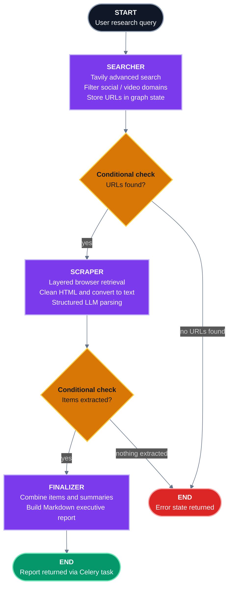

<div align="center">

# CogniPulse

### Autonomous AI Market Intelligence.<br/>From Research Queries to Structured Insights.


<br/>

**CogniPulse** is a full-stack, agentic AI platform that turns a plain-English market research question into a structured Markdown intelligence report. It discovers public web sources, retrieves their content with browser automation, extracts validated structured data with an LLM, and presents the result in a live dashboard.

<br/>


<br/>

[Overview](#executive-overview) · [Problem & Solution](#the-problem) · [Features](#key-features) · [Architecture](#system-architecture) · [Agent Workflow](#ai-agent-workflow) · [Scraping](#web-scraping-engineering)

[AI Extraction](#structured-ai-extraction) · [Async Processing](#asynchronous-background-processing) · [Tech Stack](#technology-stack) · [API](#api-documentation) · [Quick Start](#installation-and-quick-start)

[Engineering Challenges](#engineering-challenges-and-solutions) · [Skills](#technical-skills-demonstrated) · [Limitations](#limitations-and-production-considerations) · [Roadmap](#future-roadmap) · [Security](#security-and-responsible-usage)

</div>

---

## Executive Overview

Market and competitor research is slow, repetitive and hard to standardize. Analysts search for sources, open page after page, wrestle with JavaScript-heavy websites, copy details into notes and then try to write something coherent.

**CogniPulse automates that entire loop.** A user submits a natural-language query such as *"Compare leading project management software competitors"*. The system then:

1. **Discovers** relevant public web sources with the Tavily Search API.
2. **Retrieves** each page through a layered browser-automation engine with fallbacks.
3. **Cleans** raw HTML into readable text.
4. **Extracts** structured intelligence (titles, pricing, availability, key specifications, summaries) with an LLM, validated by Pydantic schemas.
5. **Compiles** the findings into a consolidated Markdown executive intelligence report.
6. **Delivers** the report to an interactive dashboard that tracks the background task live.

> [!NOTE]
> **In 20 seconds:** CogniPulse is an agentic research pipeline. Type a research question, get a structured market intelligence report. The work runs asynchronously in a Celery worker, orchestrated as a stateful LangGraph workflow.

### At a Glance

| | |
|---|---|
| **Input** | A natural-language market research or competitor-analysis query |
| **Output** | A structured Markdown executive intelligence report (exportable as Markdown or JSON) |
| **Agent workflow** | 3 LangGraph nodes: Searcher, Scraper, Finalizer, with conditional error routing |
| **Source discovery** | Tavily advanced search, up to 5 candidate URLs per configured request |
| **Retrieval strategy** | 3 layers: primary retrieval, SP2 fallback, SP3 (Nodriver) fallback |
| **LLM concurrency** | Parsing limited to 3 concurrent operations through an asyncio semaphore |
| **Execution model** | FastAPI accepts the job (HTTP 202); Celery + Redis run it in the background |
| **Infrastructure** | Docker Compose with 4 services: Redis, backend, Celery worker, frontend |

**Example research queries**

- Analyze AI automation market trends.
- Compare leading project management software competitors.
- Analyze electric vehicle market pricing.
- Research luxury villa communities and prices in the UAE.
- Extract product features, prices, specifications and availability from relevant websites.

---

## The Problem

Manual online market research breaks down in predictable ways:

| Pain Point | What Actually Happens |
|---|---|
| **Manual source discovery** | Finding credible, relevant pages means running many searches and filtering noise by hand. |
| **Time-consuming competitor research** | Each competitor or product requires opening, reading and comparing multiple pages. |
| **Dynamic website content** | Many modern sites render content with JavaScript, so a simple HTTP request returns an empty shell. |
| **Unstructured information** | Prices, features and availability are scattered across inconsistent page layouts. |
| **Manual extraction** | Copying details into notes or spreadsheets is slow and error-prone. |
| **Inconsistent research reports** | Two analysts researching the same market produce differently structured outputs. |

## The Solution

CogniPulse replaces the manual loop with an automated, repeatable pipeline.

| Step | Manual Workflow | CogniPulse Workflow |
|---|---|---|
| **Find sources** | Search engines, tabs, bookmarks | Tavily advanced search, automatic URL selection and domain filtering |
| **Read pages** | Open each page, wait for scripts, scroll | Browser automation with dynamic rendering and fallback retrieval |
| **Clean content** | Ignore navigation, ads and clutter mentally | BeautifulSoup cleaning and html2text conversion |
| **Extract facts** | Copy prices, specs and availability by hand | LLM extraction validated against Pydantic schemas |
| **Consolidate** | Write a summary in a document | Automatic Markdown executive report |
| **Track progress** | Unknown until finished | Task ID, status polling, elapsed time and activity history in the dashboard |

---

## Key Features

| Capability | What It Does |
|---|---|
| **Agentic AI orchestration** | A LangGraph `StateGraph` coordinates Searcher, Scraper and Finalizer nodes with shared state and conditional error routing. |
| **Intelligent search** | Tavily advanced search discovers candidate sources and the Searcher filters selected social-media and video domains. |
| **Layered browser retrieval** | A primary SeleniumBase UC + Playwright (CDP) engine, followed by two independent fallbacks (SP2 and SP3 Nodriver), maximizes best-effort retrieval success. |
| **Structured LLM extraction** | OpenRouter models, accessed through the OpenAI Python SDK, return data parsed and validated through Pydantic. |
| **Resilient LLM access** | Configurable model, API key rotation, rate-limit retry handling and input text truncation. |
| **Asynchronous execution** | Long-running research never blocks an HTTP request; Celery workers process jobs through Redis. |
| **Interactive dashboard** | Dark, responsive Next.js interface with query submission, example queries, connection status and a configurable API base URL. |
| **Live task monitoring** | Frontend polling shows Celery task status, task ID, elapsed time and an activity event history. |
| **Markdown report generation** | The Finalizer builds an executive report with titles, price/budget information, availability and key specifications. |
| **Export options** | Copy the report, or export it as Markdown or JSON. |
| **Containerized infrastructure** | Docker Compose defines Redis, backend, Celery worker and frontend services. |

---

## System Architecture

CogniPulse is organized into five cooperating layers. The diagram below shows the complete request lifecycle from the user's query to the rendered report.

```mermaid
%%{init: {"theme": "dark", "flowchart": {"curve": "basis", "nodeSpacing": 40, "rankSpacing": 46}, "themeVariables": {"fontSize": "14px", "lineColor": "#64748B"}}}%%
flowchart TB
    classDef actor fill:#101827,stroke:#94A3B8,stroke-width:2px,color:#F8FAFC
    classDef ui fill:#2563EB,stroke:#93C5FD,stroke-width:2px,color:#F8FAFC
    classDef api fill:#0891B2,stroke:#67E8F9,stroke-width:2px,color:#F8FAFC
    classDef queue fill:#059669,stroke:#6EE7B7,stroke-width:2px,color:#F8FAFC
    classDef agent fill:#7C3AED,stroke:#C4B5FD,stroke-width:2px,color:#F8FAFC
    classDef data fill:#101827,stroke:#38BDF8,stroke-width:2px,color:#F8FAFC
    classDef ext fill:#D97706,stroke:#FCD34D,stroke-width:2px,color:#101827
    classDef out fill:#101827,stroke:#34D399,stroke-width:2px,color:#F8FAFC

    USER["<b>User / Researcher</b><br/>Natural-language research query"]:::actor
    FE["<b>Next.js Frontend</b><br/>React 19 · TypeScript · Query form"]:::ui
    API["<b>FastAPI REST API</b><br/>POST /api/v1/run-agent<br/>Pydantic validation"]:::api
    DISP["<b>Celery Task Dispatch</b><br/>Job queued, task_id created"]:::queue
    BROKER[("<b>Redis</b><br/>Message broker")]:::queue
    WORKER["<b>Celery Worker</b><br/>Executes the research task"]:::queue
    LG["<b>LangGraph Workflow</b><br/>StateGraph · shared state"]:::agent
    SEARCH["<b>Searcher Node</b><br/>Query to candidate URLs"]:::agent
    TAV["<b>Tavily Search API</b><br/>External · advanced search · up to 5 URLs"]:::ext
    SCRAPE["<b>Scraper Node</b><br/>Retrieve, clean, extract"]:::agent
    ENGINE["<b>Scraping Engine</b><br/>Layered retrieval strategy"]:::data
    BROWSER["<b>Browser Retrieval + Fallbacks</b><br/>Primary · SP2 · SP3 Nodriver"]:::data
    CLEAN["<b>BeautifulSoup + html2text</b><br/>HTML to readable text"]:::data
    LLM["<b>OpenRouter LLM</b><br/>External · via OpenAI SDK<br/>max 3 concurrent parses"]:::ext
    PYD["<b>Pydantic Structured Extraction</b><br/>Validated items + summaries"]:::data
    FIN["<b>Finalizer Node</b><br/>Assemble executive report"]:::agent
    REPORT["<b>Markdown Intelligence Report</b><br/>final_report"]:::out
    RESULT[("<b>Redis Result Backend</b><br/>Task state + result")]:::queue
    STATUS["<b>Task Status API</b><br/>GET /api/v1/task-status/task_id"]:::api
    DASH["<b>Frontend Report Dashboard</b><br/>Polls ~2.2 s · renders · exports"]:::ui

    USER --> FE
    FE -->|"submit query"| API
    API -.->|"202 Accepted + task_id"| FE
    API --> DISP
    DISP -->|"enqueue"| BROKER
    BROKER -->|"deliver task"| WORKER
    WORKER -->|"invoke graph"| LG
    LG --> SEARCH
    SEARCH -->|"search request"| TAV
    TAV -->|"discovered URLs"| SCRAPE
    SCRAPE --> ENGINE
    ENGINE --> BROWSER
    BROWSER -->|"raw HTML"| CLEAN
    CLEAN -->|"clean text"| LLM
    LLM -->|"model response"| PYD
    PYD -->|"validated items"| FIN
    FIN --> REPORT
    REPORT -->|"store task result"| RESULT
    RESULT -->|"read state + result"| STATUS
    STATUS -->|"JSON status + report"| DASH
```



**Legend:** ⬛ user and data-processing steps · 🟦 presentation layer · 🔷 API layer · 🟩 asynchronous execution layer · 🟪 agentic intelligence layer (LangGraph) · 🟧 external services

### Architectural Layers

| Layer | Technologies | Responsibility |
|---|---|---|
| **Presentation** | Next.js, React, TypeScript, Tailwind CSS | Query input, example queries, task monitoring, Markdown report display and export |
| **API** | FastAPI, Uvicorn, Pydantic | Request validation, task dispatching, task-status retrieval |
| **Asynchronous Execution** | Celery, Redis | Background job execution, message brokering, task result storage |
| **Agentic Intelligence** | LangGraph `StateGraph` | Searcher, Scraper and Finalizer nodes with conditional error routing |
| **Data Acquisition & AI** | Tavily, SeleniumBase, Playwright, Nodriver, BeautifulSoup, html2text, OpenRouter, OpenAI SDK, Pydantic | Source discovery, page retrieval, cleaning, structured LLM extraction |

### Request Lifecycle

1. The user submits a research query in the Next.js dashboard.
2. The frontend calls `POST /api/v1/run-agent`.
3. FastAPI validates the request, dispatches a Celery task and returns **HTTP 202 Accepted** with a task ID.
4. Redis brokers the task to a Celery worker.
5. The worker runs the LangGraph workflow: Searcher, Scraper, Finalizer.
6. The final report and result metadata are stored in the Redis result backend.
7. The frontend polls `GET /api/v1/task-status/{task_id}` roughly every 2.2 seconds.
8. When the task is ready, the dashboard renders the Markdown report and enables copy and export.

> [!IMPORTANT]
> **Three separate responsibilities.** **LangGraph** manages the *agent workflow* (which step runs next and how errors route). **Celery** manages *asynchronous background execution* (running that workflow outside the HTTP request). **Redis** is the *broker and result backend* that moves tasks to workers and stores task state and results. They are complementary, not interchangeable.

---

## AI Agent Workflow

The core of CogniPulse is a LangGraph `StateGraph` with three primary nodes. Each node reads from and writes to shared graph state, and conditional edges decide whether to continue or terminate with an error.



### Node 1: Searcher

- Receives the user's research query.
- Sends it to the Tavily Search API using **advanced search**.
- Retrieves **up to five** candidate URLs from the configured search request.
- Filters selected social-media and video domains.
- Stores the discovered URLs in the graph state.
- Returns an **error state** if no URLs are found.

### Node 2: Scraper

- Receives the discovered URLs from graph state.
- Retrieves each page through the layered browser-automation engine (see [Web Scraping Engineering](#web-scraping-engineering)).
- Cleans extracted content and converts HTML into readable text.
- Sends page content to the LLM parser for structured extraction.
- Uses an **asyncio semaphore** to cap concurrent LLM parsing at **three operations**.
- Collects extracted structured items and summaries.
- Returns an **error state** when no structured items can be extracted.

### Node 3: Finalizer

- Collects the extracted items.
- Combines the available market summaries.
- Builds a structured Markdown executive intelligence report that includes extracted titles, price or budget information, availability status and key specifications.
- Returns the generated report through the Celery background task.

### Conditional Error Routing

After the Searcher and after the Scraper, the graph checks whether the step produced usable output. If not, the workflow terminates with an error state instead of continuing with empty data. This prevents the Finalizer from generating a meaningless report and surfaces the failure to the caller through the task result.

---

## Web Scraping Engineering

Modern websites often render their content with JavaScript, block automated clients or fail intermittently. CogniPulse addresses this with a **layered retrieval strategy**: if one retrieval method fails, a different one is attempted.

| Layer | Technology | Approach |
|---|---|---|
| **Primary retrieval** | SeleniumBase UC + Playwright over Chrome DevTools Protocol (CDP) | UC browser management, Playwright attached over CDP, dynamic rendering, randomized browser configurations, retry handling, CAPTCHA/block detection, HTML retrieval |
| **Fallback 1: SP2** | Separate Playwright implementation | Additional browser context, page scrolling and interaction, secondary retrieval attempt |
| **Fallback 2: SP3** | Nodriver | Isolated multiprocessing execution, timeout handling, process cleanup |
| **Cleaning** | BeautifulSoup4 | Cleans retrieved HTML content |
| **Conversion** | html2text | Converts cleaned HTML into readable Markdown-style text for the LLM |

```text
Target URL
   │
   ├─► Primary retrieval  (SeleniumBase UC + Playwright via CDP)
   │       └─ if it fails ─► SP2 fallback  (separate Playwright implementation)
   │                              └─ if it fails ─► SP3 fallback  (Nodriver, isolated process)
   ▼
Raw HTML ─► BeautifulSoup cleaning ─► html2text conversion ─► Readable text for the LLM parser
```

**Why layers?** Each layer uses a different browser-control approach. A failure mode that affects one (a rendering quirk, a blocked session, a hung browser) is less likely to affect all of them. Running Nodriver in an isolated process with timeouts and cleanup also keeps a misbehaving browser from compromising the worker.

> [!WARNING]
> Retrieval is **best-effort and website-dependent**. CogniPulse does not claim to bypass every CAPTCHA, bot-protection system or access restriction, and it should only be used on content you are permitted to access.

---

## Structured AI Extraction

### From Unstructured Pages to Structured Intelligence

A web page is **unstructured**: navigation, marketing copy, prices, specifications and availability are mixed into one stream of text. Reports and comparisons need **structured** data with predictable fields. The parser bridges that gap.

| Stage | Description |
|---|---|
| **Input** | Cleaned, readable page text produced by BeautifulSoup and html2text; long inputs are truncated before being sent to the model |
| **Model access** | OpenRouter as the LLM gateway, called through the OpenAI Python SDK |
| **Model selection** | Configurable with the `llm_model_name` environment variable, with a configured default/fallback |
| **Resilience** | API key rotation and retry handling for rate-limit responses |
| **Validation** | Responses are parsed and validated against Pydantic schemas |
| **Output** | Structured competitor/product items (titles, price or budget information, availability, key specifications) plus market summaries |

> [!NOTE]
> CogniPulse uses existing LLMs through OpenRouter. It does **not** include fine-tuning, model training or a proprietary model.

**Conceptual illustration (not the exact schema):**

| Raw page fragment | Structured result |
|---|---|
| *"Pro plan: $24/user/month, billed annually. Includes timeline view, API access and priority support. In stock."* | Title or product name, price or budget information, availability status, key specifications |

Using Pydantic means a malformed or incomplete model response is detected at the schema boundary instead of silently flowing into the final report.

---

## Asynchronous Background Processing

A CogniPulse run searches the web, drives browsers and calls an LLM several times. That can take well over a minute, far too long to hold an HTTP request open. The application therefore uses a standard asynchronous job pattern.

| Component | Role |
|---|---|
| **FastAPI** | Validates the request, dispatches a Celery task and immediately returns **HTTP 202 Accepted** with a task ID and status endpoint |
| **Celery** | Defines and executes the background task that runs the LangGraph workflow |
| **Redis (broker)** | Delivers queued tasks to the worker |
| **Redis (result backend)** | Stores task state and the final result |
| **Celery worker** | Pulls tasks from the queue and runs the research pipeline |
| **Status polling** | The frontend repeatedly calls `GET /api/v1/task-status/{task_id}` until the task is ready |
| **Result retrieval** | When ready, the task result contains the final report and execution metadata |

```text
POST /api/v1/run-agent ──► 202 Accepted + task_id
                              │
        Celery worker runs LangGraph workflow in the background
                              │
GET /api/v1/task-status/{id} ──► PENDING ... SUCCESS ──► result with final_report
```

---

## Technology Stack

### Active in the Application

| Technology | Category | Purpose in CogniPulse | Engineering Knowledge Demonstrated |
|---|---|---|---|
| **Python 3.12** | Backend | Main backend language | Modern Python, async patterns, modular service design |
| **FastAPI** | Backend | REST API, request validation, task dispatch and status endpoints | API design, HTTP semantics (202 Accepted), OpenAPI documentation |
| **Uvicorn** | Backend | ASGI server for FastAPI | ASGI application serving |
| **Pydantic v2** | Backend / AI | Request validation and structured LLM output schemas | Schema-first design, data validation at system boundaries |
| **asyncio** | Backend | Concurrency control, including the 3-operation LLM semaphore | Asynchronous programming, bounded concurrency |
| **python-dotenv** | Backend | Loads environment configuration | Secrets and configuration management |
| **LangGraph** | Agent orchestration | Stateful Searcher, Scraper, Finalizer workflow with conditional routing | Agentic AI design, state machines, error-aware flow control |
| **Celery** | Distributed systems | Background execution of the research workflow | Task queues, worker processes, non-blocking API design |
| **Redis** | Distributed systems | Celery message broker and result backend | Broker/result-backend architecture |
| **OpenRouter** | AI | LLM API gateway with configurable model | Provider-agnostic LLM integration |
| **OpenAI Python SDK** | AI | OpenRouter-compatible model communication | SDK integration, API compatibility |
| **Tavily Search API** | Search | Intelligent web source discovery | Search API integration, source filtering |
| **Playwright** | Browser automation | Dynamic page retrieval (primary over CDP, plus SP2 fallback) | Headless/real-browser automation, CDP integration |
| **SeleniumBase** | Browser automation | UC browser management and CDP integration | Browser lifecycle management, anti-fragility techniques |
| **Nodriver** | Browser automation | SP3 fallback retrieval in an isolated process | Multiprocessing isolation, timeout and cleanup handling |
| **BeautifulSoup4** | Data processing | HTML content cleaning | HTML parsing and data cleaning |
| **html2text** | Data processing | Converts cleaned HTML to readable Markdown-style text | Preparing unstructured data for LLM consumption |
| **Next.js 15** | Frontend | Application framework | Modern React framework usage |
| **React 19** | Frontend | Component-based dashboard UI | Component architecture, state and effects |
| **TypeScript 5.9** | Frontend | Type-safe frontend code | Static typing in UI code |
| **Tailwind CSS** | Frontend | Styling foundation for the dark, responsive interface | Utility-first, responsive design |
| **Framer Motion** | Frontend | UI transitions and animations | Interaction and motion design |
| **GSAP + ScrollTrigger** | Frontend | Scroll-triggered animations and effects | Scroll-based animation |
| **Lucide React** | Frontend | Interface iconography | Icon system integration |
| **React Markdown + Remark GFM** | Frontend | Renders the report with GitHub Flavored Markdown support | Safe Markdown rendering, tables and lists |
| **Docker** | DevOps | Backend (Python 3.12.8) and frontend (Node.js 22 Alpine) images | Containerization |
| **Docker Compose** | DevOps | Four-service local stack: Redis, backend, Celery worker, frontend | Multi-container orchestration |

### Present in the Repository but Not Part of the Active Workflow

| Item | Status |
|---|---|
| **Three.js hero component** (`components/hero-scene.tsx`) | Exists in the repository but is **not imported** into the active main page. No 3D scene is a live feature. |
| **Browser-local run-storage helper** (`lib/`) | A helper exists, but the active main page does not integrate a persistent recent-run history. |
| **Legacy helper files and documentation** | Some frontend files still reference an earlier iteration of the project (BidForge, with a proposal-generation workflow). They are not part of the active application, which is CogniPulse and communicates only with the endpoints documented below. |

---

## Frontend Experience

The active frontend is a dark, modern, responsive dashboard built with Next.js, React and TypeScript.

| Area | Implemented Behavior |
|---|---|
| **Research input** | Natural-language query submission with ready-made example queries |
| **Connection awareness** | API connection status indicator (backend health checked about every 25 seconds) |
| **Configuration** | Configurable API base URL |
| **Execution monitoring** | Celery task status, task ID and elapsed execution time, with status polling about every 2.2 seconds while a task runs |
| **Activity history** | An event history of frontend and API interactions |
| **Report rendering** | Markdown intelligence report rendered with React Markdown and Remark GFM |
| **Report actions** | Copy report, export as Markdown, export as JSON |
| **Motion** | Framer Motion transitions and GSAP ScrollTrigger scroll animations |
| **Layout** | Responsive sections for desktop and smaller screens |

> [!NOTE]
> The activity history records **frontend and API events**, not internal Celery worker logs. The progress visualization reflects the task status returned by the API and is **not** exact per-node LangGraph telemetry.

---

## API Documentation

The backend exposes three endpoints. Interactive OpenAPI documentation is available at `/docs` when the server is running (for example `http://127.0.0.1:8800/docs`).

| Method | Endpoint | Purpose | Success Status |
|---|---|---|---|
| `GET` | `/` | Health check | `200 OK` |
| `POST` | `/api/v1/run-agent` | Start a research task | `202 Accepted` |
| `GET` | `/api/v1/task-status/{task_id}` | Retrieve task state and result | `200 OK` |

> [!NOTE]
> The JSON responses below are **illustrative examples, not actual production responses**. Use `/docs` for the authoritative schema. Invalid request bodies are rejected by FastAPI/Pydantic validation (typically `422 Unprocessable Entity`).

### `GET /`: Health Check

Reports backend availability, including service status, service name, version and documentation information.

```bash
curl http://127.0.0.1:8800/
```

### `POST /api/v1/run-agent`: Start a Research Task

**Request body**

```json
{
  "query": "Analyze AI automation market trends and competitors"
}
```

```bash
curl -X POST http://127.0.0.1:8800/api/v1/run-agent \
  -H "Content-Type: application/json" \
  -d '{"query": "Analyze AI automation market trends and competitors"}'
```

**Illustrative response (`202 Accepted`)**

```json
{
  "task_id": "example-task-id",
  "status_url": "/api/v1/task-status/example-task-id"
}
```

### `GET /api/v1/task-status/{task_id}`: Poll Task Status

Returns the task ID, the Celery execution state, whether the task is ready, whether it succeeded, and the task result when available.

```bash
curl http://127.0.0.1:8800/api/v1/task-status/example-task-id
```

**Illustrative completed-task result**

```json
{
  "status": "Success",
  "task_id": "example-task-id",
  "execution_time_seconds": 45.5,
  "error_message": null,
  "final_report": "# Enterprise Competitor Intelligence Report",
  "items_extracted": 12
}
```

### Task Lifecycle

```text
Submitted ──► Queued in Redis ──► Running in Celery worker ──► Success  (final_report available)
                                                          └──► Failure  (error information available)
```

---

## Project Structure

```text
CogniPulse/
│
├── backend/
│   ├── agent_graphs.py        # FastAPI app, Celery app and LangGraph workflow entry point
│   ├── search_setup.py        # Tavily search integration
│   ├── scraper_engine.py      # Scraping orchestration
│   ├── scraping_retr.py       # Browser retrieval implementation
│   ├── scraping_retr_2.py     # Additional browser retrieval implementation
│   ├── bs4_engine.py          # HTML cleaning
│   ├── parser_engine.py       # LLM structured extraction
│   ├── requirements.txt
│   └── Dockerfile
│
├── frontend/
│   ├── app/
│   │   ├── page.tsx           # Active dashboard page
│   │   ├── layout.tsx
│   │   └── globals.css
│   │
│   ├── components/
│   │   ├── hero-scene.tsx     # Three.js hero (present, not imported by the active page)
│   │   ├── scroll-motion.tsx
│   │   └── ui/
│   │
│   ├── lib/
│   ├── package.json
│   ├── package-lock.json
│   ├── next.config.mjs
│   └── Dockerfile
│
├── docker-compose.yml
├── .env.example
├── frontend/.env.local.example
├── project_run_commands
└── README.md
```

---

## Installation and Quick Start

There are two ways to run CogniPulse: **local development** (recommended and described first) and **Docker Compose**, which needs one configuration adjustment before it works end to end.

### Prerequisites

| Requirement | Notes |
|---|---|
| **Python 3.12** | Matches the backend Docker image (Python 3.12.8) |
| **Node.js 22** | Matches the frontend Docker image (Node.js 22 Alpine) |
| **Redis** | Local install or a Redis container |
| **Google Chrome** | Used by the browser-automation layers |
| **Tavily API key** | For source discovery |
| **OpenRouter API key** | For LLM extraction |

### 1. Clone the Repository

```bash
git clone https://github.com/mrfaizan-dev/CogniPulse-AI-Market-Intelligence.git
cd cognipulse-agentic-intelligence-engine
```

### 2. Start Redis

```bash
docker run -d --name cognipulse-redis -p 6379:6379 redis:7-alpine
```

> On Windows, run Redis through Docker Desktop or WSL.

### 3. Configure Backend Environment Variables

Create `backend/.env` from the provided `.env.example`:

```bash
cp .env.example backend/.env
```

```env
TAVILY_API_KEYS=your_tavily_api_key
OPENROUTER_API_KEYS=your_openrouter_api_key
llm_model_name=your_openrouter_model
REDIS_URL=redis://localhost:6379/0
```

| Variable | Purpose |
|---|---|
| `TAVILY_API_KEYS` | Tavily API key (the application also supports configured multi-key handling) |
| `OPENROUTER_API_KEYS` | OpenRouter API key (supports key rotation when configured with multiple keys) |
| `llm_model_name` | OpenRouter model identifier used for extraction |
| `REDIS_URL` | Redis connection string used by Celery. Use `redis://localhost:6379/0` locally. |

> These are **example configurations**. Never commit real API keys, and never place backend secrets in `NEXT_PUBLIC_` variables.

### 4. Install Backend Dependencies

**macOS / Linux**

```bash
cd backend
python3.12 -m venv .venv
source .venv/bin/activate
pip install -r requirements.txt
```

**Windows PowerShell**

```powershell
cd backend
py -3.12 -m venv .venv
.\.venv\Scripts\Activate.ps1
pip install -r requirements.txt
Copy-Item ..\.env.example .env
```

If Playwright reports that browsers are missing, install them with `playwright install chromium`.

### 5. Start the FastAPI Backend

From the `backend/` directory, with the virtual environment active:

```bash
uvicorn agent_graphs:app --host 127.0.0.1 --port 8800
```

> **Port note:** running the module directly through its Python entry point uses port **8000**. The frontend example configuration and Docker Compose use **8800**, so use the command above for a consistent local setup.

### 6. Start the Celery Worker

Open a second terminal, activate the same virtual environment and run:

```bash
celery -A agent_graphs.celery_app worker --loglevel=info -P solo
```

> **Windows:** Celery's default prefork pool is not supported on Windows, so the **`-P solo`** pool is required there. The same command is used in this project for local development on all platforms.

### 7. Configure and Start the Frontend

```bash
cd frontend
npm install
cp .env.local.example .env.local
```

```env
NEXT_PUBLIC_API_BASE_URL=http://127.0.0.1:8800
```

```bash
npm run dev
```

On Windows PowerShell, use `Copy-Item .env.local.example .env.local`.

### 8. Open the Application

| Service | URL |
|---|---|
| **Dashboard** | `http://localhost:3000` |
| **Backend health** | `http://127.0.0.1:8800/` |
| **Interactive API docs** | `http://127.0.0.1:8800/docs` |

Submit one of the example queries and watch the task move from queued to complete.

### Docker Compose

`docker-compose.yml` defines four services (Redis, backend, Celery worker, frontend), publishes the backend on port **8800** and the frontend on port **3000**, and sets `REDIS_URL` for the containers.

> [!IMPORTANT]
> The current Compose file does **not** pass the required Tavily and OpenRouter variables to the backend and worker containers. Without them, the stack starts but research tasks cannot call the search or LLM providers. Add an `env_file` to **both** the backend and Celery worker services before running a real query.

```yaml
# docker-compose.yml: add to BOTH the backend and the Celery worker services
    env_file:
      - .env
```

Your root `.env` should then contain `TAVILY_API_KEYS`, `OPENROUTER_API_KEYS` and `llm_model_name`. The `REDIS_URL` already set in Compose (`redis://redis:6379/0`) points to the Redis container.

```bash
docker compose up --build
```

> The backend Dockerfile's default command references `api_main:app`, while the FastAPI application lives in `agent_graphs.py`. Docker Compose overrides the command with the correct module, so Compose runs correctly, but running the bare image without the override will not start the app. The frontend's API base URL can also be changed from the dashboard UI.

---

## Engineering Challenges and Solutions

| Engineering Challenge | Technical Approach | Engineering Value |
|---|---|---|
| **Extracting data from JavaScript-rendered websites** | Real browser rendering through SeleniumBase UC and Playwright over CDP instead of plain HTTP requests | Captures content that never appears in a static HTML response |
| **Website retrieval failures** | Retry handling, randomized browser configurations, CAPTCHA/block detection and a fallback chain | Improves best-effort retrieval reliability without pretending failures never occur |
| **Layered scraping fallbacks** | Primary retrieval, then SP2 (separate Playwright implementation), then SP3 (Nodriver) | Different browser-control approaches reduce the chance that one failure mode blocks every attempt |
| **Browser lifecycle and resource management** | Managed browser sessions, separate browser contexts, timeouts and process cleanup | Limits hung or leaked browser processes inside a long-running worker |
| **Multiprocessing isolation** | Nodriver retrieval runs in an isolated process with timeout handling | A stuck fallback can be terminated without taking down the worker's main process |
| **Long-running AI workflows** | A multi-stage workflow executed outside the request cycle | HTTP requests stay fast and the user is never left waiting on an open connection |
| **Background task orchestration** | FastAPI dispatches a Celery task; Redis brokers it to a worker | Cleanly separates API handling from heavy computation and enables horizontal worker scaling |
| **LLM rate limits** | Retry handling for rate-limit responses | Transient provider limits do not immediately fail the pipeline |
| **Multiple API key management** | Configurable single/multi-key handling with key rotation | Spreads load across keys and reduces single-key exhaustion |
| **Unstructured-to-structured data transformation** | Cleaning, text conversion, input truncation and LLM extraction into defined fields | Turns inconsistent web pages into comparable, report-ready records |
| **AI output validation** | Pydantic schemas validate model responses | Malformed model output is caught at a defined boundary |
| **Asynchronous concurrency management** | An asyncio semaphore limits concurrent LLM parsing to three operations | Bounds provider load and rate-limit pressure while still parsing in parallel |

---

## Technical Skills Demonstrated

Every skill below is tied to a concrete part of the implementation.

### Backend Engineering

| Skill | Demonstrated By |
|---|---|
| **Python** | Backend services, async code and modular engines for search, scraping, cleaning and parsing |
| **FastAPI & REST API design** | Health, task-submission and status endpoints; HTTP 202 for accepted background work |
| **Pydantic** | Request validation and LLM output schemas |
| **Async programming** | Semaphore-limited concurrent LLM parsing |
| **Uvicorn** | ASGI serving of the API |

### Agentic AI Engineering

| Skill | Demonstrated By |
|---|---|
| **LangGraph / StateGraph orchestration** | Three-node Searcher, Scraper, Finalizer workflow with shared graph state |
| **Multi-stage agent workflows** | Discovery, retrieval and extraction, then report synthesis |
| **Conditional routing** | Error checks that terminate the graph when no URLs or items are produced |
| **LLM API integration** | OpenRouter through the OpenAI SDK with a configurable model |
| **Structured AI extraction** | Page text converted to validated structured items |

### AI and Data Engineering

| Skill | Demonstrated By |
|---|---|
| **OpenRouter & OpenAI SDK** | Provider-flexible LLM access |
| **Schema validation** | Pydantic-validated model responses |
| **HTML parsing & data cleaning** | BeautifulSoup cleaning of retrieved pages |
| **Text preparation for LLMs** | html2text conversion and input truncation |
| **Structured information extraction** | Titles, price/budget, availability and key specifications |

### Web Scraping and Browser Automation

| Skill | Demonstrated By |
|---|---|
| **Search API integration (Tavily)** | Advanced search, URL selection and domain filtering |
| **Playwright** | Primary CDP-attached retrieval and the SP2 fallback |
| **SeleniumBase** | UC browser management and CDP integration |
| **Nodriver** | Isolated, timeout-guarded SP3 fallback |
| **BeautifulSoup & html2text** | Cleaning and converting retrieved HTML |

### Distributed Systems

| Skill | Demonstrated By |
|---|---|
| **Celery** | Background execution of the full research workflow |
| **Redis** | Message broker and result backend |
| **Background task processing** | HTTP 202 submission with decoupled worker execution |
| **Task status management** | Status endpoint exposing state, readiness, success and result |

### Frontend Engineering

| Skill | Demonstrated By |
|---|---|
| **Next.js & React** | Interactive research dashboard |
| **TypeScript** | Type-safe UI code |
| **Responsive UI** | Dark, responsive dashboard sections |
| **Framer Motion & GSAP** | UI transitions and scroll-triggered animation |
| **Markdown rendering** | React Markdown with GFM for report display, plus copy and export actions |
| **Polling UX** | Task-status polling with elapsed time, task ID and activity history |

### DevOps

| Skill | Demonstrated By |
|---|---|
| **Docker** | Backend and frontend container images |
| **Docker Compose** | Four-service multi-container stack |
| **Environment configuration** | API keys, model name and Redis URL kept out of source code |
| **Multi-container architecture** | Separate API, worker, broker and frontend services |

---

## Limitations and Production Considerations

CogniPulse is a functional engineering project, not a hardened production service. These are the current limitations.

| Area | Current State | Path Toward Production |
|---|---|---|
| **Web retrieval** | Best-effort and website-dependent; CAPTCHAs and access restrictions can block retrieval | Source-specific adapters, compliant data providers, improved retry policies |
| **LLM accuracy** | Extracted values can be incomplete or wrong; human review is required | Review workflows and stronger validation rules |
| **Persistence** | No persistent database or stored research history | Database-backed run and report storage |
| **Authentication** | No user authentication or authorization | Auth, per-user access control and rate limiting |
| **Source citations** | Final reports do not include a complete source-URL citation system | Per-item source provenance in extracted data and reports |
| **Progress visibility** | No real-time per-node telemetry; progress is derived from task status | Streaming events from the LangGraph workflow |
| **Live updates** | HTTP polling instead of WebSockets or Server-Sent Events | WebSocket or SSE progress channel |
| **Docker setup** | Compose needs an `env_file` for API keys, and the backend Dockerfile's default command references `api_main:app` (overridden by Compose) | Align Dockerfile and Compose configuration |
| **CORS** | Permissive for development (all origins) | Restrict to trusted origins |
| **Observability** | Basic logging only; no monitoring platform | Structured logging, metrics and tracing |
| **Testing & CI** | Automated test suite and CI/CD pipeline not yet part of the project | Unit, integration and workflow tests with CI |

Not currently demonstrated by the active implementation: a vector database, a complete RAG pipeline, a human approval/resume workflow or user accounts.

---

## Future Roadmap

> The items below are **proposed future work**. They are not implemented features.

- [ ] Source URL provenance and citations in reports
- [ ] Persistent research history
- [ ] Database integration
- [ ] Authentication and authorization
- [ ] WebSocket or Server-Sent Events progress updates
- [ ] Per-node LangGraph monitoring
- [ ] Human-in-the-loop review
- [ ] Improved retry policies
- [ ] Automated tests
- [ ] CI/CD pipeline
- [ ] Production observability
- [ ] Additional report export formats

---

## Security and Responsible Usage

- **Keep API keys server-side.** Tavily and OpenRouter keys belong in backend environment variables only, never in `NEXT_PUBLIC_` variables or committed files.
- **Protect environment files.** Keep `.env` files out of version control and use a secrets manager in deployed environments.
- **Add authentication and rate limiting before any public deployment.** The current API has neither.
- **Treat URL fetching as a security boundary.** A public deployment needs URL validation and SSRF protections.
- **Respect target websites.** Follow terms of service and robots policies, and avoid collecting private or restricted content.
- **Review AI-generated findings.** Verify important facts against original sources before making business decisions.

---

## Project Summary

CogniPulse is a full-stack agentic AI application that automates the market research loop end to end. A Next.js dashboard submits a natural-language query to a FastAPI backend; Celery and Redis run the work asynchronously; and a LangGraph workflow discovers sources with Tavily, retrieves pages through a layered browser-automation engine, cleans the content, extracts Pydantic-validated structured data through OpenRouter, and compiles a Markdown executive intelligence report.

Its engineering value lies in how the pieces fit together: a stateful agent workflow with explicit error routing, resilient retrieval with isolated fallbacks, bounded LLM concurrency with retry and key rotation, a clean separation between API, worker and agent responsibilities, and honest documentation of its current limits and next steps.

---

## Developer Attribution

Designed and developed by **Mr Faizan**.

<div align="center">

<sub>CogniPulse: Autonomous AI Market Intelligence</sub>

</div>
