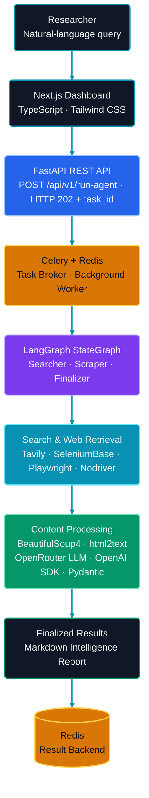
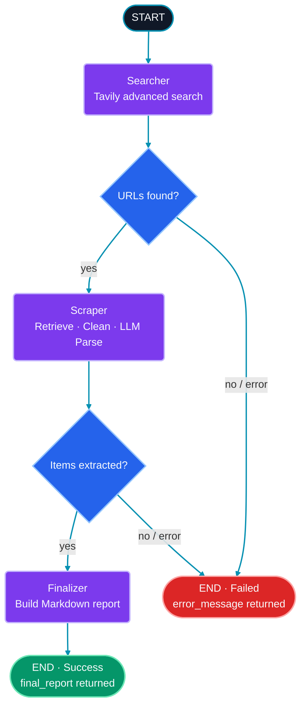

<div align="center">


# CogniPulse

### *From Natural-Language Research Queries to Structured Intelligence.*

**An AI-powered market intelligence and autonomous web research platform.**

Turn a plain-English research question into a structured, executive-ready Markdown report using live public web sources, browser automation, and LLM-powered extraction.


[Overview](#overview) · [Quick Start](#-quick-start-docker) · [Features](#core-features) · [Architecture](#-architecture) · [Agent Workflow](#agent-workflow) · [Technical Details](#technical-implementation) · [Tech Stack](#technology-stack-and-engineering-skills) · [API](#api-reference) · [Local Development](#local-development-optional) · [Limitations](#limitations-and-roadmap)

</div>

---

## What Is CogniPulse?

CogniPulse is an AI-powered market intelligence and autonomous web research platform. It takes a natural-language question, searches the public web, retrieves relevant pages, extracts structured information with an LLM, and produces an executive-ready Markdown report.

Traditional market research can involve opening many websites, navigating JavaScript-heavy pages, collecting details manually, and organizing findings. CogniPulse brings these steps into one automated workflow to help reduce repetitive research effort.

### How it works

1. **Search:** Tavily discovers up to five relevant public-web URLs for the research query.
2. **Retrieve:** A layered browser-automation engine attempts to retrieve each page.
3. **Analyze:** Cleaned page content is sent to an LLM through OpenRouter.
4. **Structure:** The model response is parsed and validated against Pydantic v2 schemas.
5. **Report:** Extracted items and summaries are combined into a Markdown intelligence report.

The report can contain titles, pricing or budget information, availability, and specifications, depending on what the source pages provide. Research runs as a background task, allowing the API to accept a request without waiting for the full research workflow to finish.

> **Research note:** Reports are LLM-generated from public web content. They are intended to accelerate research, not replace source verification. Check important findings against the original websites before making business decisions.

---

## 🚀 Quick Start (Docker)

The recommended way to try CogniPulse is with Docker Compose. Docker builds and runs the frontend, backend, Redis, and Celery worker for you.

### Before you begin

You need:

- **Docker Desktop** on Windows/macOS, or **Docker Engine and the Docker Compose plugin** on Linux.
- An active internet connection for the first build and live web research.
- A **Tavily API key** for web search.
- An **OpenRouter API key** for LLM-based extraction.
- An OpenRouter model ID that supports the structured output required by the application.

For the Docker setup, you do **not** need to install Python, Node.js, or Redis separately on your computer. Docker builds the application containers and starts the Redis service.

### Step 1 — Get the project

```bash
git clone https://github.com/mrfaizan-dev/CogniPulse-AI-Market-Intelligence.git
cd CogniPulse-AI-Market-Intelligence
```


### Step 2 — Create Your Local `.env` File

The repository includes a `.env.example` file as a template. Copy it to create your own local `.env` configuration file.

**🪟 Windows (PowerShell):**

```powershell
Copy-Item .env.example .env
```

**🐧 Linux / 🍎 macOS (Terminal):**

```bash
cp .env.example .env
```

### Step 3 — Open `.env` and Configure Your Credentials

Open the newly created `.env` file using your preferred text editor.

**🪟 Windows (PowerShell — Notepad):**

```powershell
notepad .env
```

**🐧 Linux / 🍎 macOS (Terminal — Nano):**

```bash
nano .env
```

Add your API keys and configure your preferred OpenRouter model ID:

```dotenv
# Tavily Web Search API Key(s)
TAVILY_API_KEYS=YOUR_TAVILY_API_KEY

# OpenRouter API Key(s)
OPENROUTER_API_KEYS=YOUR_OPENROUTER_API_KEY

#(Optional)
# OpenRouter Model ID (must support structured output)
llm_model_name=YOUR_OPENROUTER_MODEL_ID

# Redis Configuration
# Docker Compose overrides this for containers
REDIS_URL=redis://localhost:6379/0
```

**Save your changes:**

- **Windows / Notepad:** Press `Ctrl + S` and close Notepad.
- **Linux / macOS / Nano:** Press `Ctrl + O`, then `Enter` to save, and `Ctrl + X` to exit.

> 🔐 **Security:** Replace all placeholder values with your actual credentials. Never share your API keys or commit your `.env` file to GitHub. Keep `.env.example` free of real credentials.


**Where to get the keys:**

- Tavily: <https://tavily.com>
- OpenRouter: <https://openrouter.ai>

Replace every placeholder before starting the application. If you use multiple keys for a provider, enter them as comma-separated values, as supported by the application.

**Keep your credentials private:** `.env` is intended for your local machine and is ignored by Git. Never commit or share your real API keys. Only `.env.example` belongs in the public repository.

**You do not need to edit `docker-compose.yml` to pass these variables.** The Compose configuration loads the root `.env` file into both the backend and Celery worker. It also sets the container's Redis address to `redis://redis:6379/0`; the `localhost` value above is the local-development default.

### Step 4 — Build and start all services

Run this command from the project root:

```bash
docker compose up --build
```

Docker Compose builds and starts the four services:

| Service | Responsibility |
|---|---|
| **Redis** | Celery message broker and result backend. |
| **Backend** | FastAPI application that accepts research requests and exposes task status. |
| **Celery worker** | Executes the LangGraph research workflow in the background. |
| **Frontend** | Next.js research dashboard. |

The first build may take longer because Docker needs to download base images and install the application and browser dependencies. Keep the terminal open while the services are running.

### Step 5 — Open CogniPulse

When the containers have started, open the dashboard:

| Service | Local address |
|---|---|
| **CogniPulse Dashboard** | <http://localhost:3000> |
| **FastAPI Backend** | <http://localhost:8800> |
| **Interactive API Documentation** | <http://localhost:8800/docs> |

Enter a natural-language research query in the dashboard and submit it. The API queues the task, the Celery worker performs the research, and the dashboard checks the task until the result is available.

### Useful Docker commands

Run these commands from the project root.

**Check service status:**

```bash
docker compose ps
```

**View backend and worker logs:**

```bash
docker compose logs -f backend celery_worker
```

**View logs for all services:**

```bash
docker compose logs -f
```

**Stop the services:**

```bash
docker compose down
```

### Troubleshooting

| Issue | What to check |
|---|---|
| Docker reports that `.env` is missing | Make sure you completed Step 2 and created `.env` in the project root (the same folder as `docker-compose.yml`). |
| Tavily or OpenRouter authentication error | Check that the corresponding key in `.env` is valid, active, and copied without extra spaces. |
| Model or structured-output error | Check that `llm_model_name` contains a valid OpenRouter model ID supported by the extraction request. |
| Port 3000 or 8800 is already in use | Stop the application using that port or free the port, then start Compose again. |
| Dashboard cannot reach the API | Check `docker compose ps`, confirm the backend is running, and inspect `docker compose logs -f backend`. |
| A research task fails or returns incomplete results | Inspect backend and Celery worker logs. Some websites may block automated retrieval, require interaction, or provide unavailable content. |
| A container exits during startup | Run `docker compose logs <service-name>` for the affected service and check the first error in its startup log. |

> **Demo requirements:** Live research requires working Tavily and OpenRouter credentials, an eligible model, and internet access. Retrieval is best-effort; no automated scraper can guarantee successful access to every website.

---

## Core Features

| Area | What it does |
|---|---|
| **Autonomous research** | Converts a natural-language query into a Tavily advanced search and discovers up to five relevant URLs. Selected social and video domains are filtered. |
| **Layered web retrieval** | Uses three browser-retrieval layers, with retries and checks for common CAPTCHA or blocking indicators. |
| **Structured extraction** | Parses LLM responses into Pydantic schemas instead of relying on unvalidated free-form text. |
| **Background execution** | FastAPI returns HTTP `202 Accepted`; Celery runs the research workflow outside the API request. |
| **Intelligence report** | Combines extracted items and available summaries into a Markdown report. |
| **Research dashboard** | Provides a Next.js interface for submitting queries, monitoring tasks, viewing reports, and exporting results. |

### Dashboard capabilities

- Natural-language query input with example research queries.
- API health indicator and configurable API URL.
- Celery task-status polling, task ID, and elapsed execution time.
- Frontend and API activity events during a run.
- Markdown report rendering, **Copy Report**, **Markdown Export**, and **JSON Export**.
- Responsive interface with Framer Motion transitions and GSAP scroll-triggered animation.

> The dashboard's progress and activity display reflects frontend and API events. It is **not** live per-node telemetry from inside the LangGraph workflow.

---

## 🏗️ Architecture

The architecture follows a top-to-bottom request path. Related technologies are grouped to keep the diagram compact while showing the complete flow from a research query to the generated report.



### Component responsibilities

| Component | Responsibility |
|---|---|
| **Next.js** | Provides the research dashboard and displays task results. |
| **FastAPI** | Accepts research requests, dispatches background jobs, and exposes task status. |
| **LangGraph** | Orchestrates the Searcher, Scraper, and Finalizer nodes using shared graph state and routing. |
| **Celery** | Executes the research workflow in a background worker, outside the HTTP request. |
| **Redis** | Acts as the Celery message broker and result backend. |

---

## Agent Workflow

The research logic is implemented as a LangGraph `StateGraph` with three nodes and conditional error routing after the Searcher and Scraper stages.



| Node | Responsibility |
|---|---|
| **Searcher** | Runs a Tavily advanced search, discovers up to five URLs, filters selected social and video domains, and stores search results in graph state. |
| **Scraper** | Retrieves each URL through the layered browser engine, cleans page content, and calls the structured LLM parser. An `asyncio` semaphore limits concurrent LLM parsing to three operations. |
| **Finalizer** | Combines extracted items and available summaries into the Markdown report, including titles, pricing or budget, availability, and specifications where available. |

The diagram is a conceptual view of the workflow. The exact routing conditions are defined in `backend/agent_graphs.py`.

---

## Technical Implementation

### 1. Layered web retrieval

Modern websites often render content with JavaScript and may respond differently to automated browser traffic. CogniPulse therefore uses a layered retrieval strategy rather than relying on a single retrieval method.

| Layer | Engine | Role |
|---|---|---|
| **Primary** | SeleniumBase UC browser with Playwright attached over the Chrome DevTools Protocol (CDP) | Main browser retrieval, retries, and checks for common CAPTCHA or blocking indicators. |
| **SP2 fallback** | Separate Playwright retrieval implementation | Attempts retrieval when the primary layer does not return usable content. |
| **SP3 fallback** | Nodriver in an isolated `multiprocessing` process | Last-resort retrieval with timeout and process-cleanup handling. |

Retrieval is best-effort. Some pages may still be inaccessible because of website restrictions, bot protection, network issues, or unsupported page behavior.

### 2. HTML cleaning and structured AI extraction

1. **Clean:** BeautifulSoup4 removes page noise, and `html2text` converts HTML into readable text.
2. **Prepare:** Input text is truncated at 100,000 characters before it is sent to the model.
3. **Extract:** An LLM served through OpenRouter is called using the OpenAI Python SDK. The model is configurable through `llm_model_name`.
4. **Validate:** Responses are parsed against Pydantic v2 schemas so malformed structured output can be rejected instead of flowing unchecked into the report.
5. **Control usage:** API-key rotation and rate-limit retry handling support provider limits. An `asyncio` semaphore limits concurrent parsing to three operations.

CogniPulse uses hosted models as provided by the selected model provider. It does not perform fine-tuning or custom model training.

### 3. Background execution

FastAPI does not perform the full research workflow inside the request. It submits a task to Celery, Redis carries the task message and stores its result, and a Celery worker executes the LangGraph workflow. This keeps the API responsive while browser retrieval and LLM calls run in the background.

---

## Technology Stack and Engineering Skills

| Category | Technologies | What the implementation demonstrates |
|---|---|---|
| **Backend** | Python 3.12, FastAPI, Uvicorn, Pydantic v2, `asyncio` | Async REST API design, request validation, and concurrency control. |
| **Agentic AI** | LangGraph, `StateGraph`, conditional routing | Multi-step workflow orchestration with shared state and explicit error paths. |
| **LLM integration and extraction** | OpenRouter, OpenAI Python SDK, Pydantic schemas | LLM integration and schema-based structured output validation. |
| **Search and browser automation** | Tavily, Playwright, SeleniumBase UC, Nodriver | Web search and browser-based retrieval from dynamic websites. |
| **Data processing** | BeautifulSoup4, `html2text` | Cleaning and converting raw HTML into readable model input. |
| **Background processing** | Celery, Redis | Background task execution, message brokering, and result storage. |
| **Frontend** | Next.js 15, TypeScript 5.9, Tailwind CSS, Framer Motion, GSAP + ScrollTrigger, Lucide React, React Markdown, Remark GFM | Responsive dashboard development, Markdown report rendering, and interface animation. |
| **DevOps** | Docker, Docker Compose | Multi-container local application setup. |

Next.js 15 is a React-based framework; React is used as its underlying UI library.

---

## API Reference

The local API base URL is `http://127.0.0.1:8800`. The examples below use illustrative values.

### Available endpoints

| Method | Endpoint | Purpose |
|---|---|---|
| `GET` | `/` | Basic API health check. |
| `POST` | `/api/v1/run-agent` | Submit a research query and queue a background task. |
| `GET` | `/api/v1/task-status/{task_id}` | Retrieve the Celery task state and application result. |

### Submit a research query

```bash
curl -X POST http://127.0.0.1:8800/api/v1/run-agent \
  -H "Content-Type: application/json" \
  -d '{"query": "Analyze AI automation market trends and competitors"}'
```

**Request body:**

```json
{
  "query": "Analyze AI automation market trends and competitors"
}
```

The endpoint returns **HTTP `202 Accepted`** with a task ID and a status-check endpoint:

```json
{
  "status": "Accepted",
  "message": "Research task queued.",
  "task_id": "example-task-id",
  "check_status_endpoint": "/api/v1/task-status/example-task-id"
}
```

### Check task status

```bash
curl http://127.0.0.1:8800/api/v1/task-status/example-task-id
```

An illustrative completed response:

```json
{
  "task_id": "example-task-id",
  "state": "SUCCESS",
  "ready": true,
  "successful": true,
  "result": {
    "status": "Success",
    "task_id": "example-task-id",
    "execution_time_seconds": 45.5,
    "error_message": null,
    "final_report": "# Market Intelligence Report",
    "items_extracted": 12
  }
}
```

### Understanding task status

There are two status levels in the response:

| Level | Fields | Meaning |
|---|---|---|
| **Celery task** | `state`, `ready`, `successful` | Indicates whether the background task has finished, for example `PENDING` or `SUCCESS`. |
| **Application workflow** | `result.status`, `result.error_message` | Indicates whether the research workflow itself succeeded. |

A graph-level failure may be returned as an application result rather than raised as a Celery exception. Therefore, a task can have Celery `state: "SUCCESS"` while `result.status` is `"Failed"`. Clients should wait until `ready` is `true`, then check `result.status` before using `result.final_report`.

---

## Local Development (Optional)

Use this approach if you want to work on the backend and frontend directly instead of running the full application through Docker. The Docker Quick Start above is the recommended route for reviewers.

### Prerequisites

- Python 3.12
- Node.js compatible with the frontend project (the frontend Docker image uses Node.js 22)
- Redis running locally
- Tavily and OpenRouter API credentials in the environment available to the backend and worker

Create the root `.env` file using the steps in [Quick Start](#-quick-start-docker). For local development, the Redis URL should point to your local Redis instance, normally `redis://localhost:6379/0`.

Start Redis before launching the API and worker. If Redis is not already installed, you can run a local Redis container:

```bash
docker run -d --name cognipulse-redis -p 6379:6379 redis:alpine
```

### Terminal 1 — Backend API

```bash
cd backend
python -m venv .venv
```

Activate the environment:

```bash
# Linux / macOS
source .venv/bin/activate

# Windows PowerShell
.venv\Scripts\Activate.ps1
```

Install dependencies and browser components:

```bash
pip install -r requirements.txt
playwright install chromium
```

Start FastAPI:

```bash
uvicorn agent_graphs:app --host 127.0.0.1 --port 8800
```

### Terminal 2 — Celery worker

Open a second terminal, activate the same backend virtual environment, and run:

```bash
cd backend

# Activate .venv using the command for your operating system, then:
celery -A agent_graphs.celery_app worker --loglevel=info -P solo
```

### Terminal 3 — Frontend

Open a third terminal:

```bash
cd frontend
npm install
npm run dev
```

Open <http://localhost:3000> and submit a research query.

### Dashboard API address

The active dashboard starts with `http://127.0.0.1:8800/` as its default API address and allows the API URL to be changed in the interface. The active page currently uses this default directly rather than reading `NEXT_PUBLIC_API_BASE_URL`. Because browser requests are sent from the user's machine, the backend port must be reachable at the configured address.

---

## Engineering Challenges

| Challenge | Why it matters | Implemented approach |
|---|---|---|
| **Dynamic websites** | JavaScript-rendered content may not appear in a basic HTTP response. | Browser rendering with CDP-connected automation. |
| **Retrieval failures** | No single browser technique works on every website. | Three-layer retrieval with independent fallback implementations. |
| **Stuck browser sessions** | A hung browser can occupy a worker and delay a task. | Timeouts and an isolated process for the last-resort retrieval layer, with cleanup handling. |
| **Long-running requests** | Research can take longer than a normal HTTP request. | Celery background execution behind an HTTP `202` response. |
| **Task coordination** | The API and worker run as separate processes. | Redis as the Celery broker and result backend. |
| **LLM rate limits** | Providers may throttle requests during a research run. | API-key rotation, retry handling, and backoff. |
| **Noisy page content** | Raw HTML can be difficult and expensive to process. | HTML cleaning, text conversion, and a 100,000-character input cap. |
| **Unreliable model output** | Free-form responses may not match the application's expected data structure. | Pydantic schema validation of structured responses. |
| **LLM concurrency** | Too many simultaneous requests can increase rate-limit errors and cost. | An `asyncio` semaphore capped at three concurrent parsing operations. |

---

## Limitations and Roadmap

### Current limitations

- Retrieval is website-dependent and best-effort; some websites will remain inaccessible.
- There is no persistent application database; task results are stored through the Redis result backend.
- User authentication is not implemented.
- Final reports do not yet provide a complete per-item source citation and provenance system.
- The dashboard does not provide genuine per-node LangGraph telemetry; it uses HTTP polling for task status and frontend/API activity.
- LLM-generated findings can be inaccurate and should be checked against original sources.
- The application is intended as a local portfolio demonstration, not as a hardened public production service.
- An automated test suite, CI/CD pipeline, and production observability platform are not currently included.

### Proposed roadmap

The following items are planned improvements and are **not currently implemented**:

- [ ] Persistent research history backed by a database.
- [ ] User accounts and authentication.
- [ ] Source URL citations and provenance in generated reports.
- [ ] WebSocket or Server-Sent Events (SSE) updates.
- [ ] Per-node agent telemetry.
- [ ] Human-in-the-loop review of extracted data.
- [ ] Automated tests and CI/CD.
- [ ] Production monitoring and observability.

---

## Security Notes

- Keep provider API keys in your local `.env` file and never commit that file to GitHub. Rotate any key that has been exposed.
- The API does not currently implement authentication. Do not expose this portfolio setup as a public internet-facing service.
- Restrict CORS to trusted origins before any production deployment.
- Keep Redis on a private network; do not publish its port publicly in a production environment.
- Respect each website's terms of service and `robots.txt` when conducting research.
- Treat model-generated output as untrusted until important findings have been verified.

---

## Project Structure

A simplified view of the repository's main files (some frontend components and supporting files are omitted):

```text
CogniPulse-AI-Market-Intelligence/
├── backend/
│   ├── agent_graphs.py       # FastAPI app, Celery app, and LangGraph workflow
│   ├── search_setup.py       # Tavily search integration
│   ├── scraper_engine.py     # Primary browser retrieval layer
│   ├── scraping_retr.py      # Playwright fallback retrieval
│   ├── scraping_retr_2.py    # Nodriver fallback retrieval
│   ├── bs4_engine.py         # HTML cleaning and text preparation
│   ├── parser_engine.py      # LLM extraction and Pydantic validation
│   ├── requirements.txt
│   └── Dockerfile
├── frontend/
│   ├── app/
│   │   └── page.tsx          # Main research dashboard
│   ├── next.config.mjs       # Next.js standalone output configuration
│   ├── package.json
│   └── Dockerfile
├── .env.example              # Safe environment-variable template
├── .gitignore               # Excludes local secrets and generated files
├── docker-compose.yml        # Redis, backend, worker, and frontend services
├── cognipulse-hero.svg
├── cognipulse-footer.svg
└── README.md
```

---

<div align="center">


**Designed and built by Mr Faizan**

</div>
