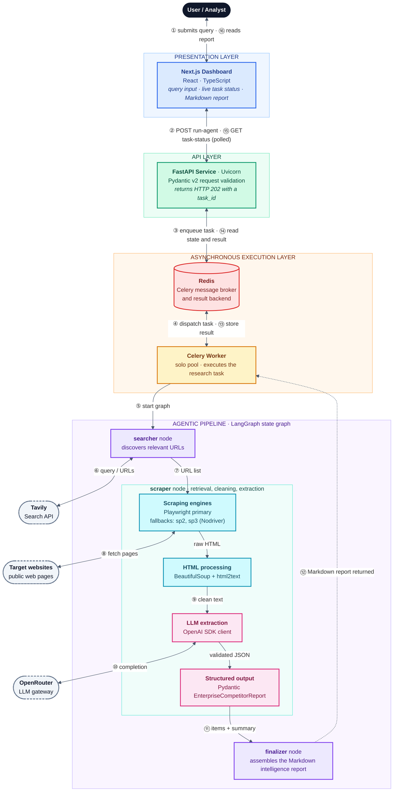
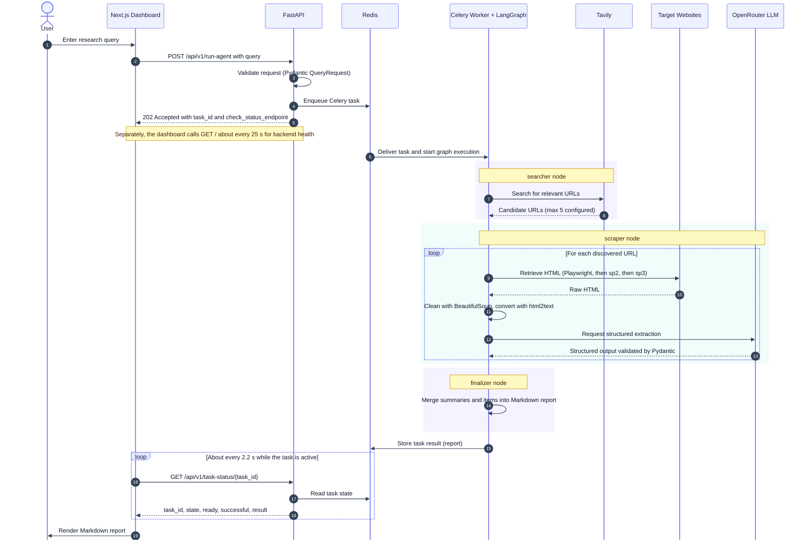
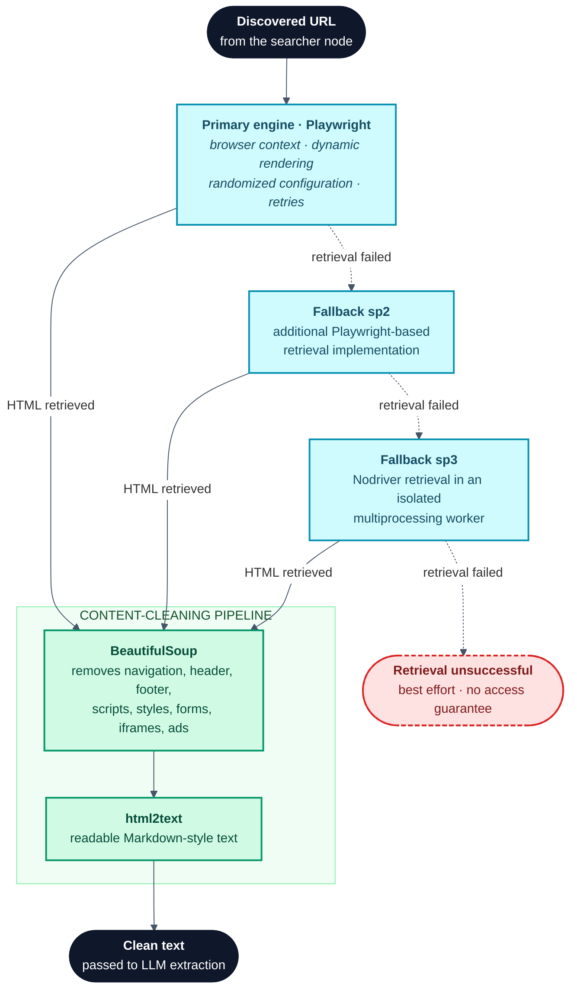
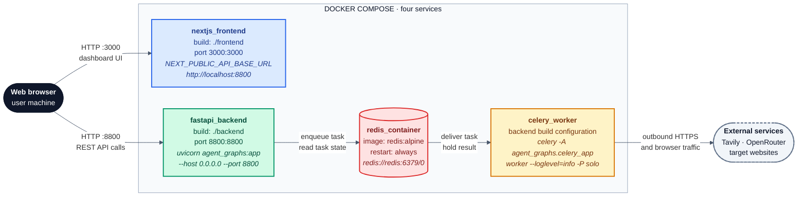

<div align="center">

# CogniPulse

### Agentic Intelligence Engine

**Autonomous web research, resilient scraping and LLM-powered competitor intelligence, orchestrated as an asynchronous agent pipeline.**

<br/>


<br/>

[Overview](#project-overview) · [Architecture](#architecture-diagram) · [Tech Stack](#complete-technology-stack) · [API](#backend-api-documentation) · [Quick Start](#installation--setup) · [Skills](#technical-skills-demonstrated) · [Limitations](#current-limitations)

</div>

---

| | |
|---|---|
| **Project type** | Full-stack agentic AI application: autonomous web research, intelligent web scraping, AI-powered market intelligence, competitor analysis |
| **Core idea** | A research query goes in; a structured Markdown intelligence report comes out, produced by a LangGraph agent pipeline running in a background worker |
| **Backend** | Python, FastAPI, Pydantic v2, Uvicorn, Celery, Redis |
| **AI layer** | LangGraph state graph, OpenRouter LLMs through the OpenAI Python SDK, Pydantic-validated structured output |
| **Data acquisition** | Tavily search, Playwright, Nodriver, BeautifulSoup, html2text |
| **Frontend** | Next.js, React, TypeScript dashboard with live task monitoring and Markdown report rendering |
| **Infrastructure** | Docker and Docker Compose (four services) |
| **Status** | Portfolio project, development-grade Docker Compose setup (see [Current Limitations](#current-limitations)) |

---

## Project Overview

**CogniPulse** is an autonomous market intelligence and web research platform. It discovers relevant web sources for a research question, extracts information from those sites, analyzes the unstructured content with large language models, and assembles the findings into a structured business intelligence report.

The application combines five engineering concerns in one system:

- **Agent-based workflow orchestration** with LangGraph (search, scrape and finalize nodes with conditional error routing).
- **Browser automation** with layered retrieval engines for dynamic, JavaScript-rendered pages.
- **Intelligent web search** through the Tavily Search API.
- **Asynchronous background processing** with Celery and Redis, so long-running research never blocks the API.
- **An interactive web dashboard** built with Next.js, React and TypeScript.

The objective is simple: turn manual web research and competitor information gathering into an orchestrated, repeatable AI workflow.

**Example research query**

> Analyze the luxury villa market in Dubai and identify competitor listings, prices, and key property features.

### Five-minute reviewer guide

| If you want to see... | Go to |
|---|---|
| The whole system on one page | [Architecture Diagram](#architecture-diagram) |
| How one request travels end to end | [End-to-End Workflow](#end-to-end-workflow) |
| How the agent graph is wired | [AI Agent Workflow](#ai-agent-workflow) |
| How scraping is made resilient | [Web Scraping Architecture](#web-scraping-architecture) |
| How LLM output is made reliable | [LLM & Structured Extraction](#llm--structured-extraction) |
| The skills this project demonstrates | [Technical Skills Demonstrated](#technical-skills-demonstrated) |
| What it deliberately does not do yet | [Current Limitations](#current-limitations) |

---

## The Problem It Addresses

Competitor and market research is still largely manual. A typical session looks like this:

1. Search engines are queried repeatedly to find relevant sources.
2. Each page is opened by hand, and many modern sites render their content with JavaScript, so simple HTTP downloads return incomplete pages.
3. Useful facts such as prices, specifications, availability and positioning are buried in navigation, advertising, scripts and boilerplate.
4. Findings are copied into notes or spreadsheets in inconsistent formats.
5. The process has to be repeated whenever the market changes.

The result is slow, repetitive, hard-to-standardize work that does not scale with the number of competitors or markets being tracked.

---

## Solution & Business Value

CogniPulse replaces the repetitive parts of that workflow with a pipeline:

| Manual step | CogniPulse approach |
|---|---|
| Finding relevant sources | Tavily-based search turns the query into a set of candidate URLs |
| Opening and reading pages | Playwright-based retrieval renders dynamic pages, with fallback engines when retrieval fails |
| Ignoring page noise | BeautifulSoup removes navigation, headers, footers, scripts, styles, forms, iframes and ads; html2text produces readable text |
| Extracting facts into notes | An LLM returns structured, Pydantic-validated data: competitor, items, prices, features, availability, pricing insight |
| Writing the summary | A finalizer node merges extracted summaries and items into a Markdown executive report |
| Waiting on long jobs | Celery runs the work in the background while the dashboard polls task status |

### Suitable research use cases

| Use case | What the pipeline can contribute |
|---|---|
| Competitor intelligence gathering | Structured per-competitor summaries of offerings and positioning |
| Product and service pricing research | Prices or budgets and pricing-strategy observations from public pages |
| Market trend research | Consolidated market summaries drawn from several sources |
| Property and real estate listing research | Listing titles, prices and key property features |
| Product specification extraction | Features and specifications pulled out of unstructured pages |
| Business information discovery | Faster identification of relevant companies, pages and offers |
| Automated online research | A repeatable query-to-report workflow |
| Structured information reporting | Consistent field-based output and a readable Markdown report |

> **Scope note.** These are suitable research use cases, not guaranteed outcomes. Results depend on what the target websites expose, whether they permit automated access, and the quality of the language model's extraction. Output should be reviewed before it informs a business decision.

---

## Key Features

**Agentic orchestration**
- LangGraph state-based workflow with three primary nodes: `searcher`, `scraper`, `finalizer`.
- Conditional routing for error handling between nodes.

**Research and retrieval**
- Tavily-based URL discovery with a configured maximum of five search results in the agent graph.
- Playwright-based primary retrieval with browser context management, randomized browser configurations, dynamic page rendering and retry handling.
- Two fallback retrieval mechanisms: `sp2` (an additional Playwright-based implementation) and `sp3` (a Nodriver-based process executed in an isolated multiprocessing worker).

**Content processing and AI extraction**
- BeautifulSoup cleaning and html2text conversion into Markdown-style text.
- OpenRouter integration through the OpenAI Python SDK, with a configurable model name (`llm_model_name`).
- Pydantic response schemas (`CompetitorProductItem`, `EnterpriseCompetitorReport`) for structured extraction.
- Multiple OpenRouter API keys with rotation between attempts, a 100,000-character input text limit and retry handling for supported API failures.

**Asynchronous execution**
- FastAPI returns `HTTP 202` immediately and dispatches a Celery background task.
- Redis serves as Celery's message broker and result backend.

**Interactive dashboard**
- Research query submission, backend health monitoring (about every 25 seconds) and task status polling (about every 2.2 seconds).
- Celery execution state, execution duration tracking and an activity event history.
- Markdown report rendering with GitHub Flavored Markdown, plus one-click copying of the report and the task ID.
- Framer Motion and GSAP (ScrollTrigger) animations, Lucide React icons.

**Containerized setup**
- Docker Compose definition for four services: Redis, FastAPI backend, Celery worker and Next.js frontend.

---

## System Architecture

CogniPulse is organized into five cooperating layers:

| Layer | Components | Responsibility |
|---|---|---|
| **Presentation** | Next.js, React, TypeScript | Query input, health and status monitoring, report display |
| **API** | FastAPI, Uvicorn, Pydantic v2 | Request validation, task dispatch, task status retrieval, API docs |
| **Asynchronous execution** | Celery worker, Redis | Background execution of research tasks; Redis carries task messages and task results |
| **Agentic pipeline** | LangGraph | State-based workflow: discover sources, retrieve and extract, assemble the report |
| **Data acquisition and intelligence** | Tavily, Playwright, SeleniumBase, Nodriver, BeautifulSoup, html2text, OpenRouter | Search, retrieval, cleaning and structured LLM extraction |

Two design points are worth stating explicitly:

- **Redis is infrastructure, not intelligence.** It is Celery's broker and result backend. The agent workflow itself lives in LangGraph.
- **The HTTP request never waits for the research.** FastAPI acknowledges the task with `202`, and the dashboard retrieves progress and results by polling.

---

## Architecture Diagram



**How to read it.** Numbers ① to ⑯ follow one research run from query submission to report display. The dashed arrow ⑫ is the pipeline's return value handed back to the Celery worker, which stores it as the task result in Redis (⑬). Dashed grey nodes are external services.

| Color | Layer | Components |
|---|---|---|
| Blue | Presentation | Next.js dashboard |
| Green | API | FastAPI service on Uvicorn |
| Red | Task state | Redis (Celery broker and result backend) |
| Amber | Execution | Celery worker |
| Violet | Agent orchestration | LangGraph `searcher` and `finalizer` nodes |
| Cyan | Retrieval and cleaning | Scraping engines, HTML processing |
| Pink | AI extraction | LLM extraction and Pydantic structured output |
| Grey, dashed | External services | Tavily, target websites, OpenRouter |

---

## Complete Technology Stack

| Category | Technology | Role in CogniPulse |
|---|---|---|
| **Programming** | Python | Backend API, agent workflow, scraping and parsing modules |
| | TypeScript | Type-safe dashboard implementation (`page.tsx`) |
| | JavaScript | Runtime and tooling foundation of the Next.js and React frontend |
| **Backend** | FastAPI | REST API, request handling, interactive documentation at `/docs` |
| | Uvicorn | ASGI server that runs the FastAPI application |
| | Pydantic v2 | Request model (`QueryRequest`) and structured LLM output schemas |
| **Agentic AI** | LangGraph | State-based workflow with `searcher`, `scraper` and `finalizer` nodes and conditional routing |
| | OpenRouter | LLM gateway; the model is configurable through `llm_model_name` |
| | OpenAI Python SDK | Client library used to call the OpenRouter-compatible API |
| **Web search** | Tavily | Discovers relevant URLs for the research query |
| **Web scraping** | Playwright | Primary browser-based retrieval and the `sp2` fallback implementation |
| | SeleniumBase | Present as a dependency/import in the scraping layer |
| | Nodriver | `sp3` fallback retrieval in an isolated multiprocessing worker |
| | BeautifulSoup | HTML cleaning and removal of non-content elements |
| | html2text | Conversion of cleaned HTML into readable Markdown-style text |
| **Asynchronous processing** | Python asyncio | Asynchronous execution within the Python backend and pipeline |
| | Celery | Background task queue and worker executing the research pipeline |
| | Redis | Celery message broker and result backend (not the workflow engine) |
| **Frontend** | Next.js, React | Application framework and UI rendering |
| | React Markdown, Remark GFM | Rendering the generated report, including GitHub Flavored Markdown |
| | Framer Motion | Component animations |
| | GSAP, ScrollTrigger | Scroll-driven animations |
| | Lucide React | Icon set |
| **DevOps** | Docker | Containerization of backend, worker and frontend |
| | Docker Compose | Orchestration of the four services on a shared Compose network |

---

## Technical Architecture Deep Dive

### Backend module responsibilities

| Module | Responsibility |
|---|---|
| `agent_graphs.py` | Entry module referenced by both the Uvicorn and Celery commands: FastAPI application (`app`), Celery application (`celery_app`) and the LangGraph agent workflow |
| `search_setup.py` | Tavily-based search: discovers relevant URLs for the query |
| `scraper_engine.py` | Primary Playwright-based retrieval engine |
| `scraping_retr.py`, `scraping_retr_2.py` | Supporting retrieval implementations behind the fallback mechanisms (`sp2`, `sp3`) |
| `bs4_engine.py` | BeautifulSoup cleaning and html2text conversion |
| `parser_engine.py` | OpenRouter integration, Pydantic extraction schemas, API key rotation, retry handling |

> Module responsibilities are derived from the project specification and module names.

### Key design decisions

| Decision | Rationale | Trade-off |
|---|---|---|
| Asynchronous dispatch with `HTTP 202` | Search, browser retrieval and LLM calls are slow; the API stays responsive while work runs elsewhere | Requires a broker, a worker and client-side polling |
| Redis limited to broker and result backend | Keeps responsibilities clean: Redis moves tasks and results, LangGraph owns workflow logic | Results are only as durable as the Redis result backend; there is no database |
| LangGraph state graph | Explicit nodes and conditional routing make the pipeline readable and extensible | Adds a framework dependency |
| Layered retrieval engines | Different sites fail in different ways; a fallback chain improves the chance of retrieving a page | Best-effort only; some sites will still block automated access |
| Process isolation for the Nodriver fallback | Runs the `sp3` retrieval in a separate multiprocessing worker, separating it from the main worker process | Extra process overhead |
| Typed LLM output with Pydantic | Responses are validated against explicit schemas instead of being treated as free text | A model can still return plausible but inaccurate content |
| Multi-key rotation | Spreads and retries requests across configured OpenRouter keys | Does not remove provider rate limits |
| Polling for status | A simple, stateless client that works with a plain REST API | More requests than push-based approaches such as WebSockets |

---

## End-to-End Workflow



| Step | What happens |
|---|---|
| **1. Query** | The user enters a research query in the Next.js dashboard |
| **2. API request** | The dashboard sends `POST /api/v1/run-agent`; FastAPI validates the body against the `QueryRequest` model |
| **3. Dispatch** | FastAPI dispatches a Celery task through Redis and returns `HTTP 202` with a `task_id` |
| **4. Background start** | The Celery worker receives the task and starts the LangGraph pipeline |
| **5. Search** | The `searcher` node uses the Tavily module to discover relevant URLs (maximum of five results configured in the agent graph) |
| **6. Retrieval** | The `scraper` node retrieves pages with Playwright, falling back to `sp2` and `sp3` when retrieval is unsuccessful |
| **7. Cleaning** | BeautifulSoup strips non-content elements and html2text converts the HTML to readable text |
| **8. Extraction** | The parser sends the text to an OpenRouter model and validates the structured response with Pydantic models |
| **9. Report** | The `finalizer` node merges market summaries and extracted items into a Markdown executive intelligence report |
| **10. Monitoring and display** | The dashboard polls `GET /api/v1/task-status/{task_id}` about every 2.2 seconds, then renders the report when the task completes |

---

## AI Agent Workflow

```mermaid
%%{init: {
  "theme": "base",
  "themeVariables": {
    "fontFamily": "Segoe UI, Inter, Arial, sans-serif",
    "fontSize": "15px",
    "lineColor": "#475569",
    "textColor": "#0F172A",
    "edgeLabelBackground": "#FFFFFF"
  },
  "flowchart": { "curve": "basis", "nodeSpacing": 45, "rankSpacing": 55, "padding": 14 }
}}%%
flowchart LR
    START(["<b>START</b>"]):::term
    SEARCHER["<b>searcher</b><br/>Tavily URL discovery<br/><i>max 5 results</i>"]:::node
    ROUTE1{{"<b>Conditional<br/>routing</b>"}}:::route
    SCRAPER["<b>scraper</b><br/>retrieve · clean · extract<br/><i>Playwright, sp2, sp3</i>"]:::node
    ROUTE2{{"<b>Conditional<br/>routing</b>"}}:::route
    FINALIZER["<b>finalizer</b><br/>merge summaries and items<br/><i>Markdown intelligence report</i>"]:::node
    END_OK(["<b>END</b><br/>report available"]):::term
    ERR["<b>Error-handling branch</b><br/><i>run leaves the normal path</i>"]:::err
    END_ERR(["<b>END</b><br/>error outcome"]):::termerr

    START --> SEARCHER --> ROUTE1
    ROUTE1 -->|"URLs found"| SCRAPER
    SCRAPER --> ROUTE2
    ROUTE2 -->|"data extracted"| FINALIZER
    FINALIZER --> END_OK
    ROUTE1 -. "error" .-> ERR
    ROUTE2 -. "error" .-> ERR
    ERR -.-> END_ERR

    classDef term fill:#0F172A,stroke:#0F172A,color:#FFFFFF,stroke-width:2px
    classDef termerr fill:#7F1D1D,stroke:#7F1D1D,color:#FFFFFF,stroke-width:2px
    classDef node fill:#EDE9FE,stroke:#7C3AED,color:#4C1D95,stroke-width:2px
    classDef route fill:#FEF3C7,stroke:#D97706,color:#78350F,stroke-width:2px
    classDef err fill:#FEE2E2,stroke:#DC2626,color:#7F1D1D,stroke-width:2px,stroke-dasharray:5 3
```



| Node | Purpose |
|---|---|
| `searcher` | Invokes the Tavily-based search module and collects candidate URLs. A maximum of five search results is configured in the agent graph |
| `scraper` | Processes the discovered URLs: retrieval with the layered engines, HTML cleaning, and structured LLM extraction |
| `finalizer` | Combines the collected market summaries and extracted items into the Markdown executive intelligence report |

**Routing.** The workflow uses conditional routing for error handling: after a node completes, the graph either continues along the normal path or diverts to an error-handling branch instead of proceeding with unusable data. The diagram shows this documented routing behavior. The concrete targets of the error branches are defined in `agent_graphs.py`.

**State-based design.** LangGraph passes shared state between nodes, so each node reads what earlier nodes produced and contributes its own output.

---

## Web Scraping Architecture



| Stage | Implementation | Notes |
|---|---|---|
| **Primary retrieval** | Playwright | Dynamic page rendering, browser context management, randomized browser configurations, HTML extraction, retry handling |
| **Fallback `sp2`** | Additional Playwright-based retrieval implementation | Used when primary retrieval is unsuccessful |
| **Fallback `sp3`** | Nodriver retrieval executed in an isolated multiprocessing worker | Separates this retrieval path into its own process |
| **HTML cleaning** | BeautifulSoup | Removes navigation, footer, header, scripts, styles, forms, iframes, advertisements and other non-content elements |
| **Text conversion** | html2text | Produces readable Markdown-style text for the LLM |

> **Important.** These mechanisms are best-effort retrieval methods. They do not guarantee access to every website, and sites that restrict automated access may still return no usable content.

---

## LLM & Structured Extraction

The parser module calls OpenRouter through the OpenAI Python SDK and requests output that conforms to Pydantic models.

| Aspect | Detail |
|---|---|
| **Gateway and client** | OpenRouter, accessed with the OpenAI Python SDK |
| **Model selection** | Configurable through `llm_model_name`; the default configured in the parser is `nvidia/nemotron-3-ultra-550b-a55b:free` |
| **API keys** | Multiple keys supported through `OPENROUTER_API_KEYS`, rotated between attempts |
| **Input limit** | Maximum input text of 100,000 characters |
| **Error handling** | Retry handling for supported API failures |
| **Output validation** | Pydantic models `CompetitorProductItem` and `EnterpriseCompetitorReport` |

### Extraction schema fields

| Field | Meaning |
|---|---|
| `competitor_name` | The competitor or company the page concerns |
| `overall_market_summary` | A summary of the market picture found in the content |
| `items_found` | The collection of extracted items (`CompetitorProductItem` entries) |
| `title` | Title of an extracted product, service or listing |
| `price_or_budget` | Price or budget information for the item |
| `key_features_or_specs` | Key features or specifications |
| `status_or_availability` | Availability or status information |
| `pricing_strategy_insight` | An observation about the competitor's pricing approach |

> Language models can misread or omit information. Treat extracted data as research input to be verified, not as ground truth.

---

## Backend API Documentation

The FastAPI backend listens on port `8800`. Interactive documentation is generated by FastAPI at `/docs`.

| Method | Endpoint | Purpose |
|---|---|---|
| `GET` | `/` | Backend health and service information |
| `POST` | `/api/v1/run-agent` | Dispatch an AI research task |
| `GET` | `/api/v1/task-status/{task_id}` | Retrieve Celery task status |
| `GET` | `/docs` | FastAPI interactive API documentation |

### `POST /api/v1/run-agent`

**Request body** (Pydantic `QueryRequest`):

```json
{
  "query": "Analyze the luxury villa market in Dubai and identify competitor listings, prices, and key property features."
}
```

**Response: `HTTP 202 Accepted`** when the background task is accepted. Response fields:

| Field | Description |
|---|---|
| `status` | Acceptance status of the request |
| `message` | Human-readable message |
| `task_id` | Identifier of the Celery task |
| `check_status_endpoint` | Endpoint to use for checking this task's status |

### `GET /api/v1/task-status/{task_id}`

| Field | Description |
|---|---|
| `task_id` | Identifier of the Celery task |
| `state` | Celery task state (for example `PENDING`, `SUCCESS`, `FAILURE`) |
| `ready` | Whether the task has finished executing |
| `successful` | Whether the task finished successfully |
| `result` | The task result payload, which contains the report when the task has completed |

---

## Frontend Dashboard

The dashboard is a single Next.js page (`page.tsx`) written in React and TypeScript.

| Capability | Detail |
|---|---|
| **Research input** | Query field and task submission to `POST /api/v1/run-agent` |
| **Backend health** | Health status indicator, refreshed about every 25 seconds |
| **Task monitoring** | Polls `GET /api/v1/task-status/{task_id}` about every 2.2 seconds while execution is active |
| **Execution insight** | Celery execution state, execution duration tracking and an activity event history |
| **Report presentation** | Markdown rendering with React Markdown and Remark GFM |
| **Productivity** | Copy the report and copy the task ID |
| **Visual design** | Framer Motion animations, GSAP and ScrollTrigger scroll animations, Lucide React icons |
| **Configuration** | API base URL, default `http://127.0.0.1:8800/`, overridable with `NEXT_PUBLIC_API_BASE_URL` |

---

## Docker & Deployment Architecture

Docker Compose is the orchestration layer that connects the separate application services into one runnable system. It builds the images, starts the containers and places them on a shared network, so the backend and worker reach Redis through the service hostname `redis`.



| Service | Container | Build / image | Port | Purpose |
|---|---|---|---|---|
| Redis | `redis_container` | `redis:alpine` | — | Celery broker and result backend; restart policy `always` |
| Backend | `fastapi_backend` | `./backend` (`./backend/Dockerfile`) | `8800:8800` | FastAPI served by Uvicorn |
| Celery Worker | `celery_worker` | Backend build configuration | — | Executes background AI research tasks with the Celery solo pool |
| Frontend | `nextjs_frontend` | `./frontend` (`./frontend/Dockerfile`) | `3000:3000` | Next.js dashboard; `NEXT_PUBLIC_API_BASE_URL` set to `http://localhost:8800` |

A dash means no port mapping is part of the documented configuration.

**Configured commands**

```bash
# Backend service
uvicorn agent_graphs:app --host 0.0.0.0 --port 8800

# Celery worker service
celery -A agent_graphs.celery_app worker --loglevel=info -P solo
```

**Redis connection used by the backend and worker:** `redis://redis:6379/0`

> The Compose setup is intended for development and demonstration. It does not define health checks, persistent Redis volumes or production-grade orchestration.

---

## Installation & Setup

> **Command reliability.** Commands marked **documented** come from the project's configured container commands. Commands marked **illustrative** are standard commands that should be checked against the repository configuration (for example `project_run_commands` and the frontend scripts) before use.

### Prerequisites

- Docker and Docker Compose (for the containerized setup), or
- Python, Node.js and a reachable Redis instance (for a local setup)
- A [Tavily](https://tavily.com) API key and an [OpenRouter](https://openrouter.ai) API key

### Option A: Docker Compose (recommended)

```bash
# 1. Clone the repository
git clone https://github.com/<your-username>/cognipulse-agentic-intelligence-engine.git
cd cognipulse-agentic-intelligence-engine

# 2. Provide the required environment variables (see "Environment Variables")
#    Supply OPENROUTER_API_KEYS and TAVILY_API_KEYS in the way docker-compose.yml expects.

# 3. Build and start all four services (illustrative)
docker compose up --build
```

Once the containers are running:

| Service | URL |
|---|---|
| Dashboard | http://localhost:3000 |
| API health | http://localhost:8800/ |
| API docs | http://localhost:8800/docs |

### Option B: Local development

**1. Redis** (illustrative)

```bash
docker run -d --name redis_container -p 6379:6379 redis:alpine
```

**2. Backend**

```bash
cd backend

# Create and activate a virtual environment (illustrative)
python -m venv .venv
source .venv/bin/activate          # Windows: .venv\Scripts\activate

# Install dependencies from requirements.txt
pip install -r requirements.txt

# Install browser binaries for Playwright (illustrative)
playwright install

# Configure environment variables (see "Environment Variables")
export OPENROUTER_API_KEYS="<your-openrouter-api-key>"
export TAVILY_API_KEYS="<your-tavily-api-key>"
export REDIS_URL="redis://localhost:6379/0"
```

**3. Start the FastAPI server** (documented)

```bash
uvicorn agent_graphs:app --host 0.0.0.0 --port 8800
```

**4. Start the Celery worker in a second terminal** (documented)

```bash
celery -A agent_graphs.celery_app worker --loglevel=info -P solo
```

**5. Frontend** (illustrative; verify the scripts defined in the frontend project)

```bash
cd frontend
npm install
export NEXT_PUBLIC_API_BASE_URL="http://localhost:8800"
npm run dev
```

**6. Verify**

```bash
curl http://localhost:8800/
```

Then open the dashboard and submit a research query.

---

## Environment Variables

| Variable | Purpose | Required | Default / notes |
|---|---|---|---|
| `OPENROUTER_API_KEYS` | OpenRouter credentials for LLM extraction. Multiple keys are supported and rotated between attempts | **Yes** | No default. Follow the key-list format expected by the parser module |
| `TAVILY_API_KEYS` | Tavily credentials for web search | **Yes** | No default |
| `REDIS_URL` | Redis connection used as the Celery broker and result backend | **Yes** for local runs | Docker Compose provides `redis://redis:6379/0`. For local runs, point it at your Redis instance |
| `llm_model_name` | OpenRouter model used for structured extraction | No | Code-level default in the parser: `nvidia/nemotron-3-ultra-550b-a55b:free` |
| `NEXT_PUBLIC_API_BASE_URL` | Backend base URL used by the dashboard | No | Code-level default in `page.tsx`: `http://127.0.0.1:8800/`. Docker Compose sets `http://localhost:8800` |

**Example configuration (placeholders only)**

```env
# Required
OPENROUTER_API_KEYS=<your-openrouter-api-key>
TAVILY_API_KEYS=<your-tavily-api-key>

# Required for local runs (provided by Docker Compose in containers)
REDIS_URL=redis://localhost:6379/0

# Optional (code-level defaults exist)
llm_model_name=<openrouter-model-name>
NEXT_PUBLIC_API_BASE_URL=http://localhost:8800
```

> **Never commit real credentials.** Keep API keys in environment variables or an untracked `.env` file. Variables prefixed with `NEXT_PUBLIC_` are embedded in the browser bundle, so they must never contain secrets.

---

## Project Directory Structure

```text
cognipulse-agentic-intelligence-engine/
├── docker-compose.yml        # Four-service Compose definition
├── project_run_commands      # Run commands reference
├── backend/                  # Build context for the FastAPI service and Celery worker
│   ├── Dockerfile
│   ├── requirements.txt      # Python dependencies
│   ├── agent_graphs.py       # FastAPI app, Celery app, LangGraph workflow
│   ├── search_setup.py       # Tavily search
│   ├── scraper_engine.py     # Primary Playwright scraping engine
│   ├── scraping_retr.py      # Supporting retrieval implementation
│   ├── scraping_retr_2.py    # Supporting retrieval implementation
│   ├── bs4_engine.py         # BeautifulSoup + html2text cleaning
│   └── parser_engine.py      # OpenRouter client, Pydantic schemas, key rotation
└── frontend/                 # Build context for the Next.js dashboard
    ├── Dockerfile
    └── page.tsx              # Dashboard page
```

> The tree reflects the Compose build contexts (`backend/`, `frontend/`) and the project file inventory. The exact placement of `requirements.txt`, `project_run_commands` and `page.tsx` within the repository, and the standard Next.js scaffolding files that surround `page.tsx`, should be confirmed against the repository.

---

## Example API Usage

**Submit a research task**

```bash
curl -X POST http://localhost:8800/api/v1/run-agent \
  -H "Content-Type: application/json" \
  -d '{"query": "Analyze the luxury villa market in Dubai and identify competitor listings, prices, and key property features."}'
```

The API answers with `HTTP 202` and a body containing `status`, `message`, `task_id` and `check_status_endpoint`.

**Check task status**

```bash
curl http://localhost:8800/api/v1/task-status/<task_id>
```

**Python: submit and poll until the task is ready**

```python
import time
import requests

BASE_URL = "http://localhost:8800"

response = requests.post(
    f"{BASE_URL}/api/v1/run-agent",
    json={"query": "Analyze the luxury villa market in Dubai and identify "
                   "competitor listings, prices, and key property features."},
    timeout=30,
)
response.raise_for_status()          # expects HTTP 202
task_id = response.json()["task_id"]

while True:
    status = requests.get(f"{BASE_URL}/api/v1/task-status/{task_id}", timeout=30).json()
    if status["ready"]:
        break
    time.sleep(2.2)                  # the dashboard polls at a similar interval

print("state:", status["state"], "| successful:", status["successful"])
print(status["result"])
```

**TypeScript / JavaScript: the same flow from a client**

```typescript
const BASE_URL = "http://localhost:8800";

const submit = await fetch(`${BASE_URL}/api/v1/run-agent`, {
  method: "POST",
  headers: { "Content-Type": "application/json" },
  body: JSON.stringify({ query: "Analyze the luxury villa market in Dubai." }),
});
const { task_id } = await submit.json();

let status;
do {
  await new Promise((resolve) => setTimeout(resolve, 2200));
  status = await (await fetch(`${BASE_URL}/api/v1/task-status/${task_id}`)).json();
} while (!status.ready);

console.log(status.state, status.result);
```

---

## Technical Skills Demonstrated

CogniPulse spans several engineering domains in a single working system.

### Backend Engineering

| Skill | Where it appears |
|---|---|
| Python development | Backend API, agent workflow, scraping and parsing modules |
| FastAPI REST API development | `run-agent`, `task-status` and health endpoints with interactive docs |
| Pydantic data validation | `QueryRequest` request model |
| Asynchronous programming | Non-blocking API design and asynchronous execution in the Python backend |
| API integration | Tavily and OpenRouter integrations |
| Error handling | Conditional graph routing, retry handling, fallback retrieval |

### AI & Agentic Systems

| Skill | Where it appears |
|---|---|
| LangGraph workflow orchestration | `searcher`, `scraper`, `finalizer` state graph with conditional routing |
| LLM integration | OpenAI Python SDK client against OpenRouter |
| OpenRouter integration | Configurable model name, multi-key rotation |
| Prompt engineering | Extraction prompts that drive structured competitor analysis |
| Structured AI data extraction | Competitor, product and pricing-insight extraction |
| Pydantic-based output schemas | `CompetitorProductItem`, `EnterpriseCompetitorReport` |

### Web Scraping & Data Engineering

| Skill | Where it appears |
|---|---|
| Playwright automation | Primary retrieval and `sp2` fallback |
| Dynamic website extraction | Rendering JavaScript-driven pages |
| BeautifulSoup HTML processing | Removal of navigation, scripts, ads and other noise |
| HTML-to-Markdown conversion | html2text conversion before LLM extraction |
| Browser automation | Browser contexts, randomized configurations, Nodriver fallback |
| Web research automation | Query to URLs to extracted data to report |
| Data cleaning | Preparing noisy HTML for model consumption |

### Distributed Systems

| Skill | Where it appears |
|---|---|
| Celery background tasks | Research pipeline runs inside a Celery worker |
| Redis message broker | Task dispatch and result backend |
| Task lifecycle monitoring | `task-status` endpoint and dashboard polling |
| Concurrent processing | Asynchronous API and background workers |
| Multiprocessing | `sp3` Nodriver retrieval in a separate worker process |
| Process isolation | Fallback retrieval separated from the main worker process |

### Full-Stack Development

| Skill | Where it appears |
|---|---|
| Next.js, React, TypeScript | Dashboard implementation |
| API integration | Task submission, health checks and status polling |
| Interactive dashboard development | Live state, duration tracking, activity history |
| Markdown rendering | React Markdown with Remark GFM |
| Frontend animation | Framer Motion, GSAP, ScrollTrigger |

### DevOps & Infrastructure

| Skill | Where it appears |
|---|---|
| Docker | Containerized backend, worker and frontend |
| Docker Compose | Four-service orchestration with service-name networking |
| Multi-container architecture | Redis, API, worker and frontend as separate services |
| Environment-based configuration | Keys, Redis URL, model name and API base URL |
| Containerized application development | Reproducible local environment |

---

## Security & Responsible Scraping

| Area | Current state | Consideration |
|---|---|---|
| **API key storage** | Keys are read from environment variables | Never commit keys. Use an untracked `.env` file locally and a secrets manager in any real deployment |
| **External API dependencies** | Depends on Tavily, OpenRouter and target websites | Availability, pricing, quotas and terms of those services apply |
| **Rate limits** | Retry handling and multi-key rotation for OpenRouter | Provider limits still apply, and free-tier models can be rate limited or change availability |
| **Error handling** | Conditional routing in the graph, retry handling, fallback retrieval | Failures are handled on a best-effort basis |
| **Browser contexts** | Browser context management in the scraping engine; Nodriver runs in an isolated worker process | Headless browsers are resource-intensive; monitor memory use in long-running workers |
| **Task reliability** | Celery with Redis as broker and result backend; Redis restart policy `always` in Compose | No persistent Redis volume or health checks are defined |
| **CORS** | The supplied FastAPI configuration allows all origins | Restrict to known origins before any non-local use |
| **Authentication** | Not implemented | Anyone who can reach the API can submit tasks |
| **Data storage** | No database and no persistent report storage | Reports are not retained as a history |
| **Access to websites** | Fallback engines do not guarantee success | Some sites will block or limit automated access |

### Responsible scraping

- Review and respect each website's terms of service and access restrictions before collecting data from it.
- No `robots.txt` or terms-of-service enforcement is documented in this project, so operators are responsible for staying within what a site permits.
- Collect only publicly available information appropriate for your use case, and keep request volumes reasonable.
- Do not use this project to bypass authentication, paywalls or access controls, or to collect personal data.
- Do not present this project as production-ready or enterprise-secure. It is a portfolio implementation with the limitations listed below.

---

## Current Limitations

- **No authentication or authorization.** The API is open to any caller that can reach it.
- **CORS allows all origins** in the supplied FastAPI configuration.
- **No database and no persistent report storage.** There is no research history beyond what the task result backend holds.
- **Best-effort scraping.** The fallback chain improves resilience but cannot guarantee access to every website.
- **Search breadth is bounded.** The agent graph is configured for a maximum of five search results per run.
- **Input size is bounded.** The parser applies a 100,000-character input text limit.
- **Single-task worker pool.** The Celery worker runs with the `solo` pool, which executes tasks one at a time per worker process.
- **Model dependence.** Extraction quality depends on the configured OpenRouter model, and the default is a free-tier model that is subject to provider rate limits and availability.
- **LLM output is not verified.** Extracted values should be checked against the source pages.
- **Development-grade orchestration.** Docker Compose here has no health checks, no persistent Redis volume and no production hardening.
- **No automated test suite or CI/CD pipeline** is established in the project inventory.

---

## Future Enhancements

> Everything in this section is **planned or potential work**. None of it is implemented today.

| Area | Potential enhancement |
|---|---|
| **Security** | Authentication and authorization; restricted CORS origins; secrets management |
| **Persistence** | Database storage for tasks and reports; historical research reports |
| **Task management** | Cancellation, retries, task queues per user and scheduled research runs |
| **Observability** | Structured logging, metrics and tracing across the API, worker and agent graph |
| **Quality** | Automated unit, integration and end-to-end test coverage |
| **Delivery** | CI/CD pipelines and container image publishing |
| **Production readiness** | Production-ready deployment topology, health checks and persistent Redis storage |
| **Scalability** | Improved worker scalability and concurrency configuration |
| **Research control** | Configurable research depth (number of sources, extraction options) |
| **Reporting** | Advanced report export, for example PDF and structured data formats |

---

## Project Summary

CogniPulse is an end-to-end agentic AI application. A user submits a research question in a Next.js dashboard; a FastAPI service validates it and hands it to a Celery worker through Redis; a LangGraph pipeline discovers sources with Tavily, retrieves pages through layered browser-automation engines, cleans the HTML, extracts structured competitor data with an OpenRouter-hosted LLM, and assembles a Markdown intelligence report that the dashboard renders.

**What the project demonstrates**

- Designing an agentic workflow with explicit state, nodes and conditional routing.
- Making LLM output dependable with typed Pydantic schemas, retries and key rotation.
- Building resilient data acquisition with browser automation, fallbacks and process isolation.
- Separating a responsive API from long-running work with Celery and Redis.
- Delivering a full-stack product, from REST API to interactive dashboard to a containerized four-service setup.
- Documenting limitations honestly, with a clear line between what exists and what is planned.

---

<div align="center">

**CogniPulse: Agentic Intelligence Engine**

Portfolio project in agentic AI, web data extraction and full-stack engineering.

</div>
